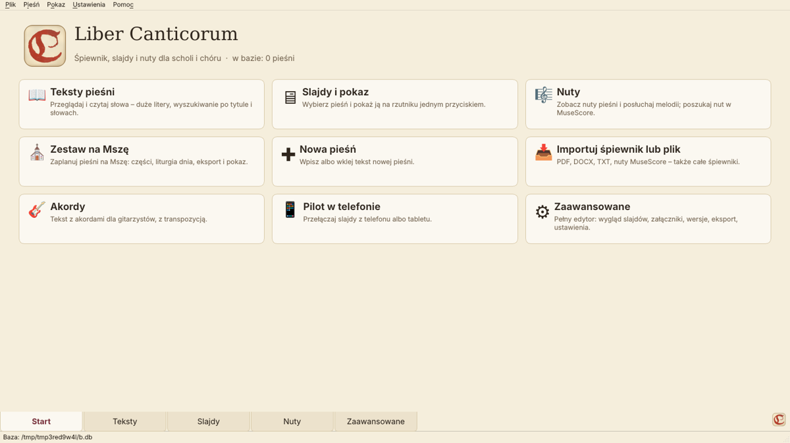
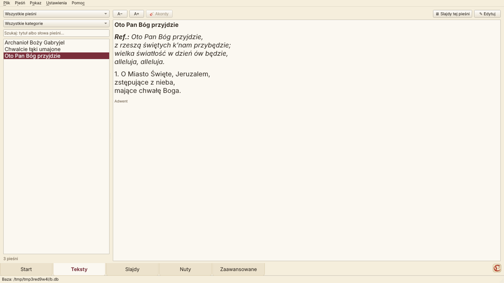
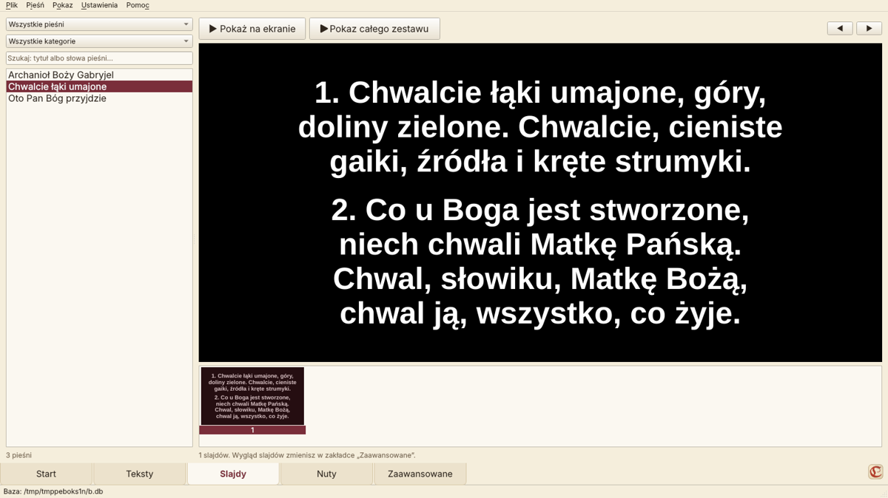
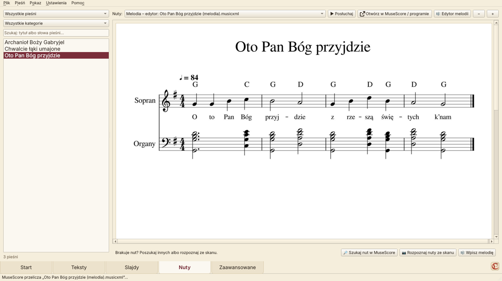
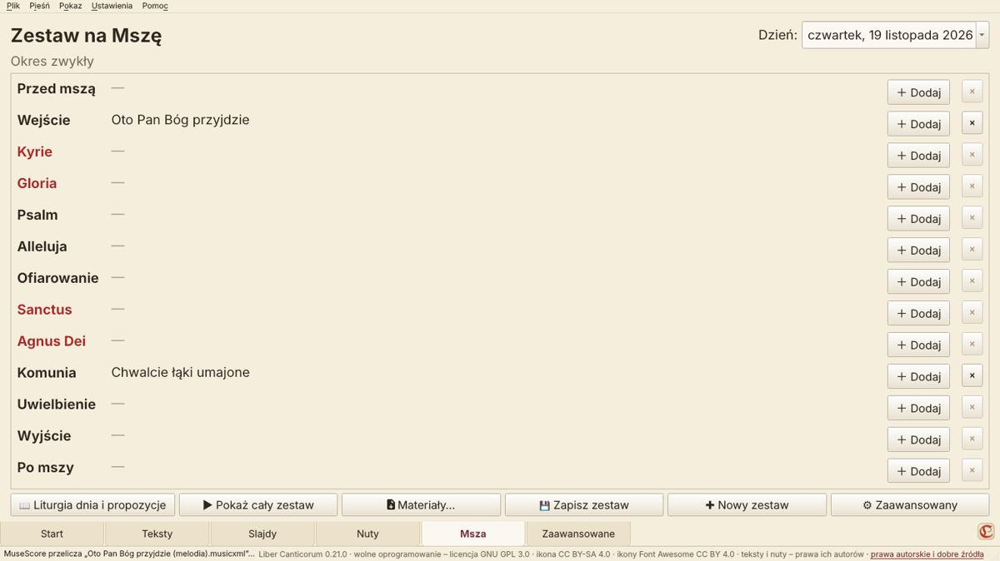
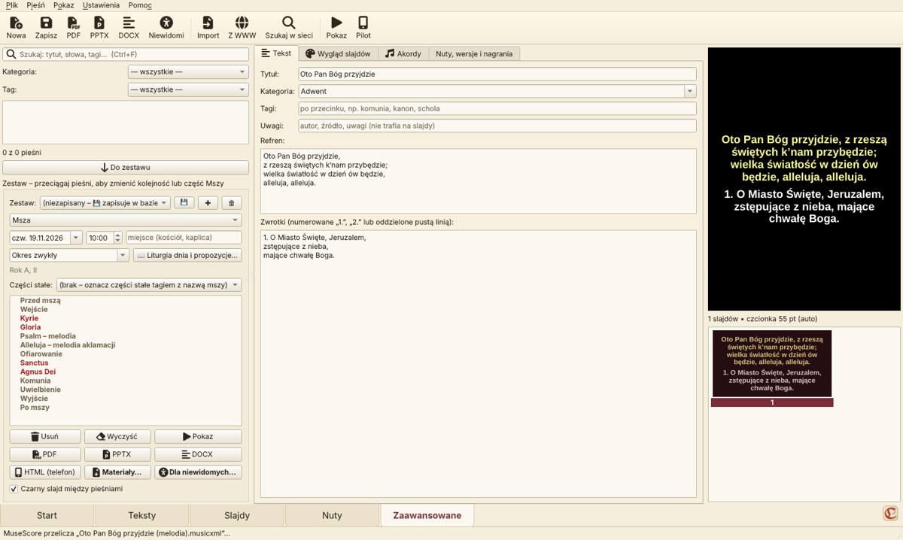

# Liber Canticorum 0.29.7
*A free liturgical songbook for musicians, choirs and Church communities*

🌐 [Polski](README.md) · **English** · [Français](README.fr.md) · [Español](README.es.md)

> **Available in 26 languages.** The program interface can be switched (🌐 on the Home screen) to: Polski · English ·
> Français · Español · Deutsch · Italiano · Português · Українська · Čeština · Slovenčina · Hrvatski · Magyar ·
> Română · Lietuvių · Svenska · Norsk · Íslenska · Kiswahili · Filipino (Tagalog) · Tiếng Việt · 日本語 · 中文 · 한국어 ·
> മലയാളം · العربية · Latina. This description exists in Polish, English, French and Spanish; speakers of other
> languages are welcome to use the English one – and to help translate (`program/i18n/<code>.json`).

*Liber canticorum* is Latin for “book of songs”. *Liber* means “book” and also echoes *libre* – free, as in free
software. The icon is the red initial **C** from the first page
of **Staniątki Cantional A** of 1586 (*Cancional pyosnek rozmaitich a naboznych*), set on a sheet of parchment.
The [Staniątki cantionals](https://pl.wikipedia.org/wiki/Kancjona%C5%82y_stani%C4%85teckie) are a collection of fifteen manuscripts (marked A–P) with settings of religious
songs, kept at the Benedictine Nuns' Abbey in Staniątki, Poland.

A program for preparing and projecting song lyrics (projector, church screen), with scores, a voice player,
a melody editor, guitar chords, a phone remote and an offline songbook. It runs on Windows, macOS and Linux.
**It starts with an empty database: you enter or import the lyrics, scores and recordings yourself** – the
package contains no songs.

Version numbers are 0.x.y: the program is still developing quickly.

## What it looks like

| Home | Lyrics |
|---|---|
|  |  |
| **Slides** | **Scores** |
|  |  |
| **Mass** | **Advanced** |
|  |  |

*The screenshots show public-domain songs typed into an empty database. The program contains no lyrics or scores.*

## Languages

The interface is available in **26 languages**: Polish, English, French, Spanish, German, Ukrainian, Czech, Italian,
Portuguese, Swahili, Japanese, Chinese, Vietnamese, Norwegian, Swedish, Icelandic, Croatian, Arabic (right-to-left),
Lithuanian, Filipino (Tagalog), Slovak,
Hungarian, Romanian, Korean, Malayalam and **Latin** (for lovers of tradition – without the guitar tile :-) ). Use the **🌐** button on the Home screen or **Settings → Language** (applies after
restart; the default is the system language). Song lyrics and scores are never translated.

Polish, English, French and Spanish cover the main parts of the program; the other languages cover the most visible
parts (tabs, menus, Home, simple views, Mass, player, melody editor, chords). Anything not yet translated is shown
in English. **Translations welcome:** the files `program/i18n/<code>.json` hold pairs “Polish text” → “translation”;
an empty `""` means “not yet translated”. `python3 program/i18n/wyciagnij_teksty.py xx` creates a new language file.
Please have the liturgical terms (parts of the Mass, liturgical seasons) checked by a native speaker.

## Window layout: tabs at the bottom

- **Home** – tiles: Song lyrics, Slides and projection, Scores, Mass set, Melody editor, **Today's liturgy**,
  **Tidy up the database**, Import a songbook or file, Chords, Phone remote, Advanced; support tiles below.
- **Lyrics** – browse lyrics in large print, search by title and words, chords with one click.
- **Slides** – choose a song and project it with one button; project the whole set.
- **Scores** – view and enlarge scores, listen, open in MuseScore, **melody editor**; find scores on MuseScore
  or recognise a scanned score.
- **Mass** – a simple Mass set in large print: the day, the parts of the Mass with songs. Next to each song:
  **📝** notes, **↺** replace, **✕** remove, and **＋ Add**. Next to each part name: **✎** rename, **🗑** remove,
  **✚** insert a new part; “✚ Add Mass part” below the list. Buttons: liturgy of the day and suggestions,
  project the set, materials, **📋 plan for musicians**, save, new set, Mass parts, advanced.
- **Advanced** – the full editor: menus, song list, slide design, chords, attachments, text versions, the full Mass
  set, export, settings.

The song lists can be filtered by **category**, **source (songbook)** and search text. Selecting several songs
(Shift/Ctrl+click) lets you merge them, set a category, tags or source for all of them at once.

## New features step by step

**New in 0.29 – a richer offline songbook for the phone.** The offline songbook (File → Export offline HTML songbook,
or ⇩ Offline in the phone remote) now has **chord transposition** by semitones (sharps or flats, remembered per song)
and shows the **Mass set divided into parts with notes for musicians** (performer, key, notes, what to watch out for).
It is a single file opened in any browser: nothing to install, no internet needed, and it sends nothing anywhere.
With scores included, the organist and choir see the scores full screen and turn pages by tapping or with a pedal.

**New in 0.27 – readings in other languages.** When the interface is not Polish, “Today's liturgy” fetches the
reading and Gospel of the day from **Vatican News** (“Word of the day”) in the interface language (English, Spanish,
French, Portuguese, and Italian and German if the page responds; otherwise English) and suggests songs from them.
Buttons open national missals: USCCB and Universalis (EN), AELF (FR), Schott – Beuron (DE), CEI (IT), Dominicos (ES);
in **Latin** the window shows the *Proprium Missae* of the 1962 Missal directly (Introitus, Oratio, Lectio, Graduale,
Evangelium, Offertorium, Secreta, Communio, Postcommunio – in Latin, from Missale Meum) and suggests songs from it.
Dates are shown in the interface language.

**Pages with readings (0.27.2).** In “Today's liturgy” the button “📋 Pages with readings – choose…” opens a list of
pages with the readings of the chosen day: Vatican News in all its languages (the “Word of the day” pages in English,
Italian, French, German, Spanish and Portuguese open directly on that day; the others open the language's home page),
national missals, Polish missals, the 1962 Ordo. You can add **your own address** with the date in it
({YYYY} {MM} {DD}), e.g. your diocese's missal – it appears at the top (★).

**New in 0.26.** A **source manager** (File → “📚 Source manager…”, the “Tidy up” tile, the ⚙ button next to the
source list) – rename, merge similar sources, add, delete; set the source of one or many selected songs with
“📚 Source for selected…”. Slide design shows **verses per slide** and **background image** at the top. The whole
program is now translated into English, including helper windows, tooltips and messages; in other languages
anything not yet translated appears in English. In **Latin**, “Today's liturgy” links to the traditional liturgy
(1962 Missal): *Proprium diei* in [Missale Meum](https://missale.bieda.it/) and the *Ordo* on [propria.org](https://propria.org/).

**Share your melodies and arrangements (0.25).** A melody you entered or your own setting (schola, choir, organ) can
help other communities: share it on [MuseScore.com](https://musescore.com/) **with an open licence** – CC0 (public
domain) or CC BY / CC BY-SA. In the melody editor: “🌍 Share on MuseScore.com…” (MusicXML export, the Upload button
and a short guide); also Help → “🌍 Share your melodies…”. Share only what you have the right to – your own settings
and public-domain melodies – and give the source of the tune and the words.

**Notes for songs in the set (0.23).** In the **Mass** tab each song has a **📝** button: performer (schola,
organist, cantor – the program remembers names), key, remarks (e.g. “verses 1, 3, 5”) and **what to watch out
for**. The notes appear under the song title and are saved with the set. **“📋 Plan for musicians”** opens a
printable table (part, song, source, key, performer, notes); the plan is also written into the “📦 Materials”
folder.

**Song source (0.23).** Every song has a **Source** field – the songbook or collection (e.g. Siedlecki, Niezbędnik
Katolika, Niepojęta Trójco). Imports from web pages fill it in automatically. You can set it in the editor or for
many selected songs at once (“📚 Source…”), and filter by it everywhere: song lists, the Mass song picker and the
**suggestions in “Today's liturgy”** (a “Source” list and column).

**Your own parts of the Mass (0.22).** Add, rename, remove and reorder parts (e.g. “To Mary”, “Closing”), and
decide whether a part may hold several songs. Songs follow a renamed part. “Restore defaults” brings back the
standard layout.

**Today's liturgy.** The readings, psalm and prayers of the day's Mass with songs from your database that echo
them (★ = from the category of the liturgical season). Choose another day, month or year, the matching mode
(broad / phrases / strict) and the source. Ordinary chants (Kyrie, Gloria…) are skipped.

**Melody editor.** Enter notes with MuseScore-style shortcuts (a digit for the value, a letter for the pitch), lyrics
and chords; multi-note selection, transposition (key and chords change too), left click = shorter value, right
click = longer. Listen with choir and organ sounds and save to the song (MusicXML, MIDI). Music fonts Leland and
Edwin (SIL OFL) from MuseScore.

**Voice player.** Score with lyrics and a cursor, keyboard and guitar chord diagrams under the score, voice colours,
transposition of the score, tempo in BPM, practise one voice, organ accompaniment below the melody, full screen by
default (“⚙ More settings” for the rest), save as MP3 / OGG / FLAC / WAV.

**Chords for guitarists** – lyrics with chords, transposition, chords centred in the free space next to the text.

## Installation

Unpack `LiberCanticorum_0.29.7.zip` and run:
- Windows: `Liber Canticorum.bat` (Python from python.org with “Add python.exe to PATH” is required),
- Linux: `Liber Canticorum.desktop` or `program/start.sh` (Debian/Ubuntu may need `sudo apt install python3-venv libportaudio2`),
- macOS: `Liber Canticorum.command`.

On first start the launcher creates an environment with the libraries (a few minutes, needs internet). The
environment is shared by all versions, so updates only install what has changed. Optional: MuseScore (score preview
and conversion), Audiveris (score recognition), a SoundFont for better sound.

## Support

The program is free. If it helps you, the Home screen tiles show how to support:
- **Centre for the Blind in Laski**, founded by Blessed Mother Elżbieta Róża Czacka – mBank **02 1140 1010 0000 4399 5800 1002**; [laski.edu.pl](https://laski.edu.pl/),
- **A parish of Our Lady of Guadalupe** – outside Poland, find the one nearest to you and support it (the tile opens a map); our own parish is Our Lady Queen of Mexico (of Guadalupe), Laski – PKO BP **18 1020 1026 0000 1102 0016 9920**; [parafiawlaskach.pl](https://parafiawlaskach.pl/),
- **Schola adHoc** – we love music, especially choral music and the music of the liturgy, and we cannot help singing :-).
  We serve the parish of Our Lady Queen of Mexico in Laski and are responsible for the Mass for abundant grace for families
  ([who we are](https://dowiaryprzezliturgie.pl/adhoc/2026/10/10/kim-jestesmy/), in Polish). Come and sing with us at
  Mass on the first Sunday of the month at noon; rehearsals on Tuesdays at 19:00 in the parish house of the same parish. Live far away, on another continent? Pray with us and send us your intention ;-); [dowiaryprzezliturgie.pl/adhoc](https://dowiaryprzezliturgie.pl/adhoc/),
- **Guadalupe500.org** – new music for the 500th anniversary of the apparitions on Tepeyac hill (in preparation) –
  get involved: compose, sing, play, write, translate.

Check the account numbers on the recipients' websites before transferring.

## Song copyright and good sources

Lyrics, melodies and arrangements of many church songs are protected by copyright. Please respect the work of
authors and publishers: give the source, do not publish other people's texts online without permission, and use
good standard sources (official hymnals, diocesan songbooks), where texts are carefully edited. The program links
to Church documents on sacred music, from St John Paul II to today (Help → “© Song copyright…”).

## Licence

**GNU GPL version 3 or later.** You may use, copy, change and distribute the program, also changed, provided you
share the source code under the same licence. No warranty. Icons: Font Awesome Free (CC BY 4.0); program icon
CC BY-SA 4.0; music fonts Leland and Edwin – SIL Open Font License. Lyrics, scores and recordings are added by the
user, who is responsible for the rights to them.
