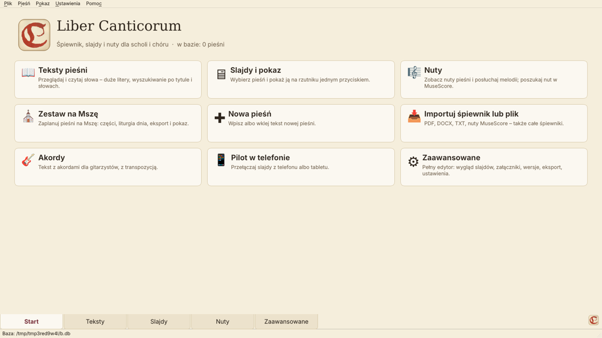
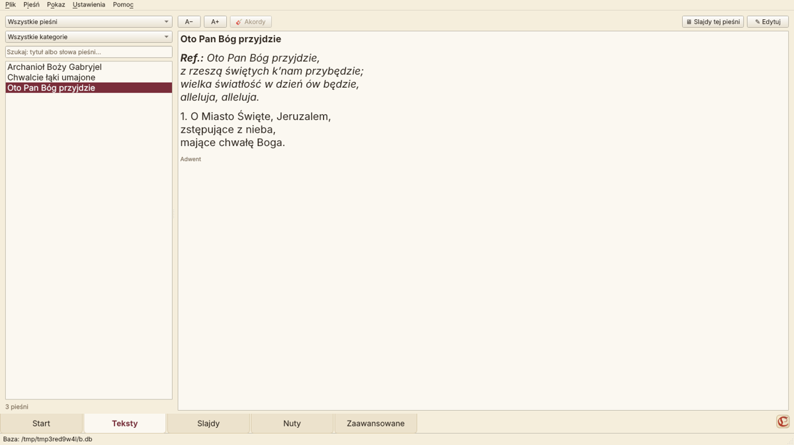
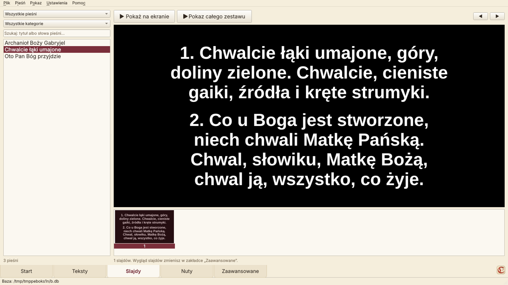
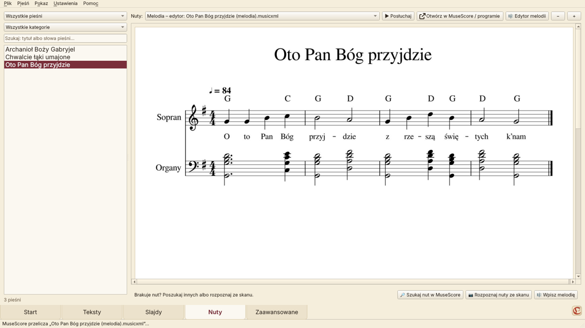
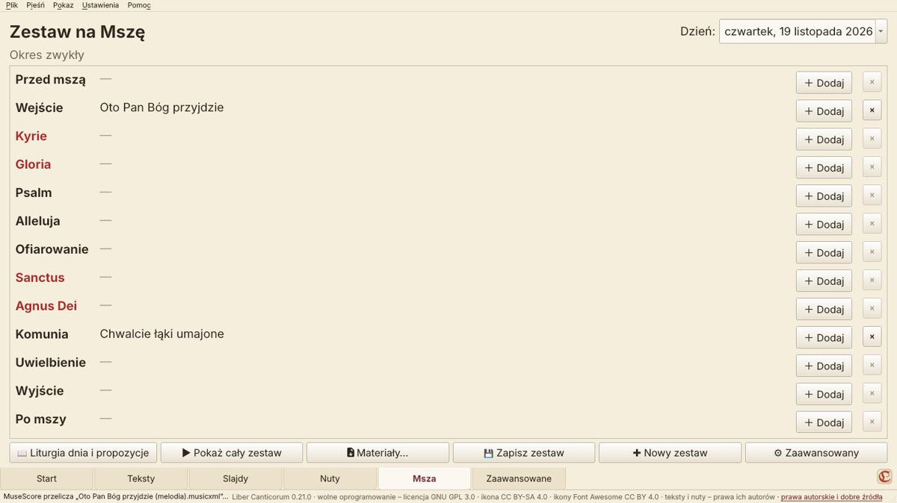
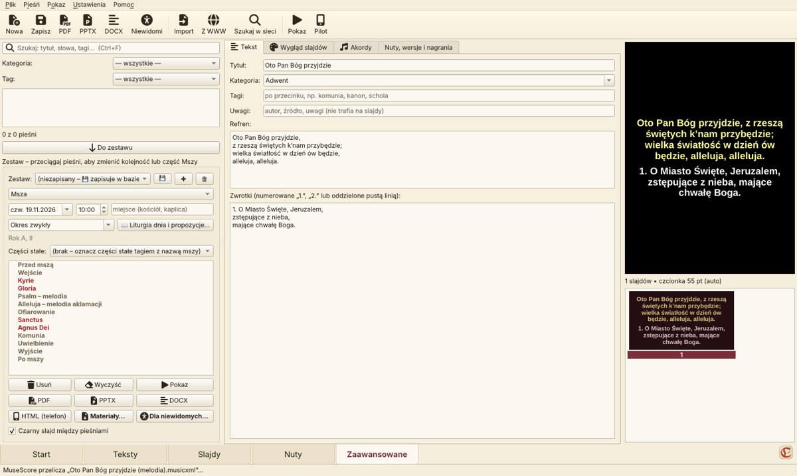

# Liber Canticorum 0.24.0
*un cancionero libre para las comunidades*

🌐 [Polski](README.md) · [English](README.en.md) · [Français](README.fr.md) · **Español**

*Liber canticorum* significa en latín «libro de cantos». *Liber* es «libro» y a la vez recuerda a *libre*, como el
software libre. El icono es la inicial roja **C** de un cantoral checo manuscrito de 1586
(*Cantional písnek rozmaitých a nábožných*), sobre una hoja de pergamino.

Un programa para preparar y proyectar las letras de los cantos (proyector, pantalla en la iglesia), con partituras,
reproductor de voces, editor de melodías, acordes para guitarra, mando en el teléfono y cancionero sin conexión.
Funciona en Windows, macOS y Linux. **Empieza con una base vacía: las letras, partituras y grabaciones las
introduces o importas tú** – el paquete no contiene ningún canto.

Los números de versión son 0.x.y: el programa sigue desarrollándose rápidamente.

## Aspecto

| Inicio | Letras |
|---|---|
|  |  |
| **Diapositivas** | **Partituras** |
|  |  |
| **Misa** | **Avanzado** |
|  |  |

*Las capturas muestran cantos de dominio público introducidos en una base vacía. El programa no contiene letras ni partituras.*

## Idiomas

La interfaz está en **21 idiomas**: polaco, inglés, francés, español, alemán, ucraniano, checo, italiano, portugués,
suajili, japonés, chino, vietnamita, noruego, sueco, islandés, croata, árabe (de derecha a izquierda), lituano y
filipino (tagalo). Botón **🌐** en la pantalla de Inicio o **Configuración → Idioma** (tras reiniciar; por defecto,
el idioma del sistema). Las letras y partituras de los cantos no se traducen.

El polaco, el inglés, el francés y el español cubren las partes principales; los demás idiomas, las más visibles
(pestañas, menús, Inicio, vistas sencillas, Misa, reproductor, editor de melodías, acordes). Lo que aún no está
traducido aparece en inglés. **Se agradecen traducciones:** los archivos `program/i18n/<código>.json` contienen
pares «texto polaco» → «traducción»; `""` = aún sin traducir. Conviene que un hablante nativo revise los términos
litúrgicos (partes de la Misa, tiempos litúrgicos).

## Disposición: pestañas abajo

- **Inicio** – mosaicos: Letras de los cantos, Diapositivas y proyección, Partituras, Repertorio de la Misa, Editor
  de melodías, **Liturgia del día**, **Ordenar la base**, Importar cancionero o archivo, Acordes, Mando en el
  teléfono, Avanzado; debajo, los mosaicos de apoyo.
- **Letras** – lectura con letra grande, búsqueda por título y palabras, acordes con un clic.
- **Diapositivas** – elige un canto y proyéctalo con un botón; proyecta todo el repertorio.
- **Partituras** – ver y ampliar la partitura, escuchar, abrir en MuseScore, **editor de melodías**; buscar
  partituras en MuseScore o reconocer una partitura escaneada.
- **Misa** – repertorio de la Misa con letra grande: el día, las partes con sus cantos. Junto a cada canto:
  **📝** notas, **↺** cambiar, **✕** quitar y **＋ Añadir**. Junto a cada parte: **✎** renombrar, **🗑** quitar,
  **✚** insertar una parte; «✚ Añadir parte de la misa» bajo la lista. Botones: liturgia del día y propuestas,
  proyección, materiales, **📋 plan para músicos**, guardar, nuevo, partes de la misa, avanzado.
- **Avanzado** – el editor completo: menús, lista de cantos, aspecto de las diapositivas, acordes, adjuntos,
  versiones del texto, repertorio completo, exportación, configuración.

Las listas se filtran por **categoría**, **fuente (cancionero)** y búsqueda. Con varios cantos seleccionados
(Mayús/Ctrl+clic) se pueden fusionar o asignarles a la vez categoría, etiquetas o fuente.

## Novedades paso a paso

**Notas para los cantos del repertorio (0.23).** En la pestaña **Misa** cada canto tiene un botón **📝**: intérprete
(coro, organista, cantor – el programa los recuerda), tonalidad, observaciones (p. ej. «estrofas 1, 3, 5») y
**puntos de atención**. Se ven bajo el título y se guardan con el repertorio. **«📋 Plan para músicos»** abre una
tabla para imprimir (parte, canto, fuente, tonalidad, intérprete, notas); también se guarda en la carpeta
«📦 Materiales».

**Fuente del canto (0.23).** Cada canto tiene un campo **Fuente** – el cancionero o la colección (p. ej. Siedlecki,
Niezbędnik Katolika, Niepojęta Trójco). Al importar desde una página web se rellena solo. Se puede fijar en el
editor o para muchos cantos a la vez («📚 Fuente…») y filtrar en todas partes: listas de cantos, elección de cantos
de la Misa y **propuestas de la «Liturgia del día»** (lista y columna «Fuente»).

**Partes propias de la Misa (0.22).** Añadir, renombrar, quitar y reordenar partes (p. ej. «A María», «Final») y
decidir si una parte admite varios cantos. Los cantos siguen a la parte renombrada. «Restaurar predeterminados»
vuelve a la disposición estándar.

**Liturgia del día.** Lecturas, salmo y oraciones de la Misa del día con los cantos de tu base que les hacen eco
(★ = categoría del tiempo litúrgico). Elige otro día, mes o año, el modo de coincidencia (amplio / frases /
estricto) y la fuente. Los cantos del ordinario (Kyrie, Gloria…) se omiten.

**Editor de melodías.** Notas con los atajos de MuseScore (una cifra para la duración, una letra para la altura),
letra y acordes; selección de varias notas, transposición (también tonalidad y acordes), clic izquierdo = valor
más corto, derecho = más largo. Escucha con coro y órgano y guarda en el canto (MusicXML, MIDI). Fuentes musicales
Leland y Edwin (SIL OFL) de MuseScore.

**Reproductor de voces.** Partitura con letra y cursor, teclado y diagramas de acordes bajo la partitura, colores de
las voces, transposición de la partitura, tempo en BPM, ensayo de una voz, acompañamiento de órgano bajo la
melodía, pantalla completa por defecto («⚙ Más ajustes»), guardar como MP3 / OGG / FLAC / WAV.

**Acordes para guitarristas** – letra con acordes, transposición, acordes centrados en el espacio libre.

## Instalación

Descomprime `LiberCanticorum_0.24.0.zip` y ejecuta:
- Windows: `Liber Canticorum.bat` (Python de python.org con «Add python.exe to PATH»),
- Linux: `Liber Canticorum.desktop` o `program/start.sh` (Debian/Ubuntu: `sudo apt install python3-venv libportaudio2`),
- macOS: `Liber Canticorum.command`.

En el primer arranque se crea un entorno con las bibliotecas (unos minutos, requiere internet), compartido por todas
las versiones. Opcional: MuseScore (vista previa y conversión de partituras), Audiveris (reconocimiento de
partituras), una SoundFont para mejor sonido.

## Apoyar

El programa es gratuito. Si te resulta útil, los mosaicos de Inicio indican cómo apoyar:
- **Centro para Ciegos de Laski** – mBank **02 1140 1010 0000 4399 5800 1002**; [laski.edu.pl](https://laski.edu.pl/),
- **Parroquia de Nuestra Señora Reina de México (de Guadalupe)**, Laski – PKO BP **18 1020 1026 0000 1102 0016 9920**; [parafiawlaskach.pl](https://parafiawlaskach.pl/),
- **Schola adHoc** – ven a cantar con nosotros el primer domingo de mes a mediodía; ensayos los martes a las 19:00
  en la casa parroquial; [dowiaryprzezliturgie.pl/adhoc](https://dowiaryprzezliturgie.pl/adhoc/),
- **Guadalupe500.org** – nueva música para el 500 aniversario de las apariciones en el cerro del Tepeyac
  (en preparación) – súmate: compón, canta, toca, escribe, traduce.

Comprueba los números de cuenta en las páginas de los destinatarios antes de transferir.

## Derechos de autor y buenas fuentes

Las letras, melodías y arreglos de muchos cantos de la Iglesia están protegidos por derechos de autor. Respeta el
trabajo de autores y editores: indica la fuente, no publiques en internet textos ajenos sin permiso y usa buenas
fuentes estándar (cantorales oficiales y diocesanos), donde los textos están bien cuidados. El programa enlaza
documentos de la Iglesia sobre la música sacra, de san Juan Pablo II hasta hoy (Ayuda → «© Derechos de autor…»).

## Licencia

**GNU GPL versión 3 o posterior.** Puedes usar, copiar, modificar y distribuir el programa, también modificado,
siempre que compartas el código fuente con la misma licencia. Sin garantía. Iconos: Font Awesome Free (CC BY 4.0);
icono del programa CC BY-SA 4.0; fuentes musicales Leland y Edwin – SIL Open Font License. Las letras, partituras y
grabaciones las añade el usuario, que responde de sus derechos.
