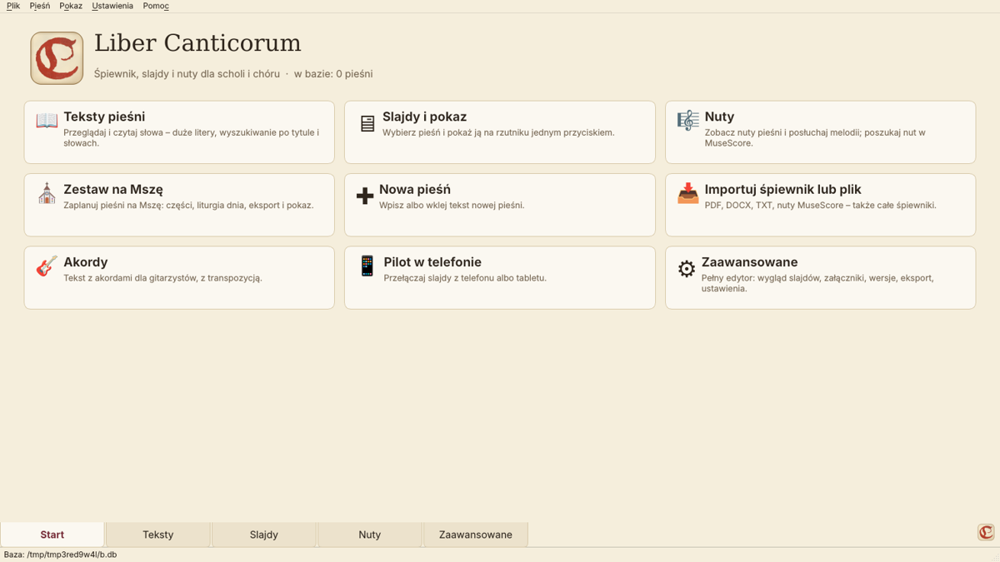
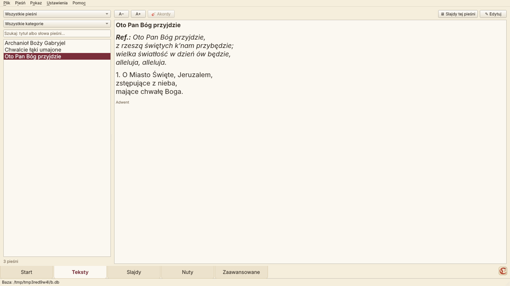
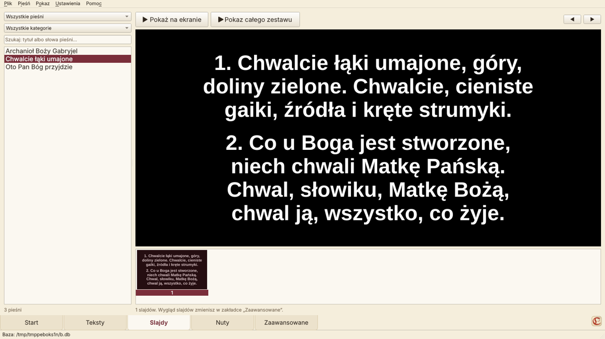
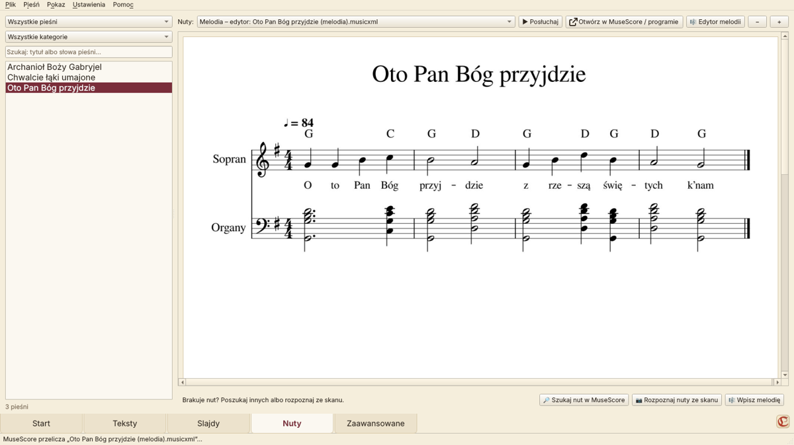
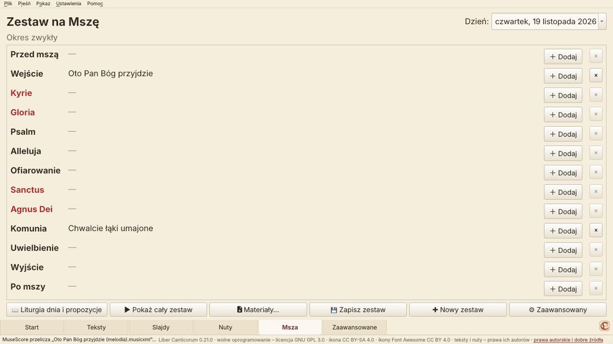
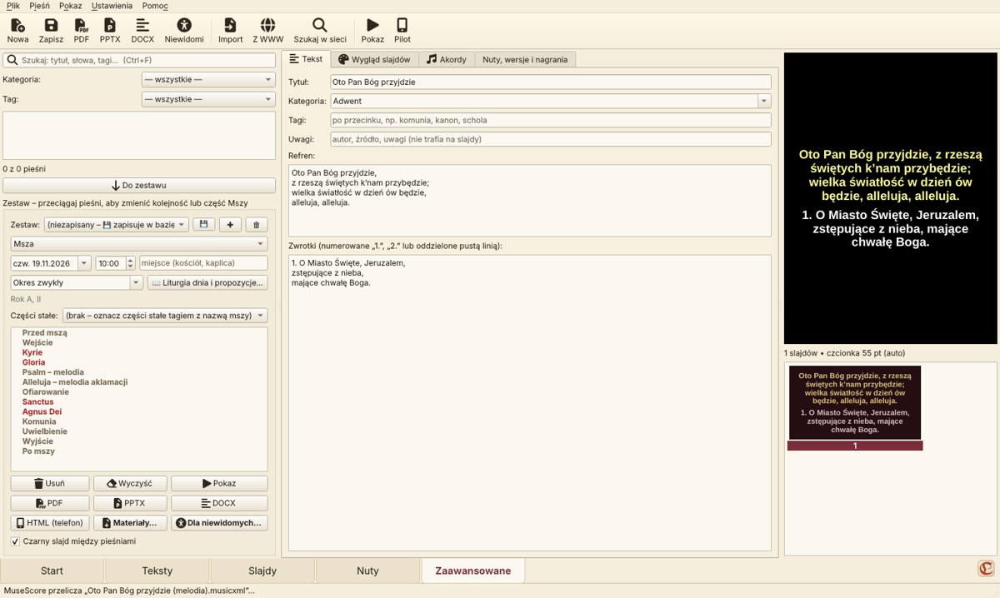

# Liber Canticorum 0.30.0
*Un recueil de chants liturgiques libre pour les musiciens, les chorales et les communautés de l'Église*

🌐 [Polski](README.md) · [English](README.en.md) · **Français** · [Español](README.es.md)

*Liber canticorum* signifie en latin « livre des chants ». *Liber* veut dire « livre » et fait aussi penser à
*libre*, comme le logiciel libre. L'icône est l'initiale rouge **C** de la première page
du **cantional A de Staniątki** (1586, *Cancional pyosnek rozmaitich a naboznych*), posée sur une feuille de parchemin.
Les [cantionals de Staniątki](https://pl.wikipedia.org/wiki/Kancjona%C5%82y_stani%C4%85teckie) sont une collection de quinze manuscrits (A–P) de chants religieux, conservée à
l'abbaye des moniales bénédictines de Staniątki (Pologne).

Un programme pour préparer et projeter les paroles des chants (vidéoprojecteur, écran à l'église), avec partitions,
lecteur de voix, éditeur de mélodie, accords pour guitare, télécommande sur téléphone et recueil hors ligne.
Il fonctionne sous Windows, macOS et Linux. **Il démarre avec une base vide : vous saisissez ou importez vous-même
les textes, partitions et enregistrements** – le paquet ne contient aucun chant.

Les numéros de version sont 0.x.y : le programme évolue encore rapidement.

## Aperçu

| Accueil | Textes |
|---|---|
|  |  |
| **Diapositives** | **Partitions** |
|  |  |
| **Messe** | **Avancé** |
|  |  |

*Les captures montrent des chants du domaine public saisis dans une base vide. Le programme ne contient ni textes ni partitions.*

## Langues

L'interface existe en **26 langues** : polonais, anglais, français, espagnol, allemand, ukrainien, tchèque,
italien, portugais, swahili, japonais, chinois, vietnamien, norvégien, suédois, islandais, croate, arabe (de droite
à gauche), lituanien, filipino (tagalog), slovaque,
hongrois, roumain, coréen, malayalam et **latin** (pour les amis de la tradition – sans la tuile guitare :-) ). Bouton **🌐** sur l'écran d'accueil ou **Paramètres → Langue**
(après redémarrage ; par défaut la langue du système). Les textes et partitions des chants ne sont pas traduits.

Le polonais, l'anglais, le français et l'espagnol couvrent les parties principales ; les autres langues couvrent
les parties les plus visibles (onglets, menus, accueil, vues simples, messe, lecteur, éditeur de mélodie, accords).
Ce qui n'est pas encore traduit s'affiche en anglais. **Les traductions sont bienvenues :** les fichiers
`program/i18n/<code>.json` contiennent des paires « texte polonais » → « traduction » ; `""` = pas encore traduit.
Faites vérifier les termes liturgiques (parties de la messe, temps liturgiques) par un locuteur natif.

## Disposition : onglets en bas

- **Accueil** – tuiles : Textes des chants, Diapositives et projection, Partitions, Programme de la messe, Éditeur
  de mélodie, **Liturgie du jour**, **Ranger la base**, Importer un recueil ou un fichier, Accords, Télécommande,
  Avancé ; en dessous, les tuiles de soutien.
- **Textes** – lecture en gros caractères, recherche par titre et paroles, accords d'un clic.
- **Diapositives** – choisir un chant et le projeter d'un bouton ; projeter tout le programme.
- **Partitions** – voir et agrandir la partition, écouter, ouvrir dans MuseScore, **éditeur de mélodie** ; chercher
  des partitions sur MuseScore ou reconnaître une partition numérisée.
- **Messe** – programme de la messe en gros caractères : le jour, les parties avec leurs chants. À côté de chaque
  chant : **📝** remarques, **↺** remplacer, **✕** retirer, puis **＋ Ajouter**. À côté de chaque partie : **✎**
  renommer, **🗑** supprimer, **✚** insérer une partie ; « ✚ Ajouter une partie » sous la liste. Boutons : liturgie
  du jour et propositions, projection, matériaux, **📋 plan pour les musiciens**, enregistrer, nouveau, parties de
  la messe, avancé.
- **Avancé** – l'éditeur complet : menus, liste des chants, aspect des diapositives, accords, pièces jointes,
  versions du texte, programme complet, export, paramètres.

Les listes se filtrent par **catégorie**, **source (recueil)** et recherche. Plusieurs chants sélectionnés
(Maj/Ctrl+clic) peuvent être fusionnés ou recevoir ensemble une catégorie, des étiquettes ou une source.

## Nouveautés pas à pas

**Nouveau en 0.30 – « Export des supports pour apprendre les chants » sur l'écran d'accueil.** Une seule fenêtre
simple : recueil PDF (paroles et partitions, avec sommaire), recueil pour téléphone (HTML hors ligne), partitions PDF,
paroles DOCX, enregistrements MP3 par voix (S, A, T, B, aussi plus lent) et version pour les personnes aveugles.

**Nouveau en 0.29 – un recueil hors ligne plus riche pour le téléphone.** Le recueil hors ligne (Fichier → Export du
recueil HTML hors ligne, ou ⇩ Offline dans la télécommande) permet maintenant de **transposer les accords** par demi-tons
et affiche le **programme de messe par parties avec les notes pour les musiciens**. C'est un seul fichier ouvert dans
n'importe quel navigateur : rien à installer, pas besoin d'internet, et il n'envoie rien.

**Nouveau en 0.27 – lectures dans d'autres langues.** Si l'interface n'est pas en polonais, la « Liturgie du jour »
télécharge la lecture et l'Évangile du jour depuis **Vatican News** (« Parole du jour ») dans la langue de l'interface
et propose des chants à partir de ces textes. Des boutons ouvrent les missels nationaux : AELF (FR), USCCB (EN),
Schott (DE), CEI (IT) ; en latin – le missel de 1962.

**Nouveau en 0.26.** Un **gestionnaire de sources** (Fichier → « 📚 Gestionnaire de sources… », tuile « Ranger »,
bouton ⚙ près de la liste des sources) – renommer, fusionner, ajouter, supprimer ; source d'un ou plusieurs chants
sélectionnés via « 📚 Source… ». Dans l'aspect des diapositives, **couplets par diapositive** et **image de fond**
sont en haut. Tout le programme est traduit en anglais ; dans les autres langues, ce qui manque s'affiche en anglais.
En **latin**, la « Liturgie du jour » renvoie à la liturgie traditionnelle (missel de 1962) :
[Missale Meum](https://missale.bieda.it/) et [propria.org](https://propria.org/).

**Partagez vos mélodies et arrangements (0.25).** Une mélodie saisie ou votre propre harmonisation (schola, chœur,
orgue) peut aider d'autres communautés : partagez-la sur [MuseScore.com](https://musescore.com/) **sous licence
libre** – CC0 (domaine public) ou CC BY / CC BY-SA. Dans l'éditeur de mélodie : « 🌍 Partager sur MuseScore.com… »
(export MusicXML, bouton Upload et petit guide) ; aussi Aide → « 🌍 Partagez vos mélodies… ». Ne partagez que ce à
quoi vous avez droit – vos arrangements et des mélodies du domaine public – en indiquant la source.

**Remarques pour les chants du programme (0.23).** Dans l'onglet **Messe**, chaque chant a un bouton **📝** :
interprète (schola, organiste, chantre – le programme s'en souvient), tonalité, remarques (p. ex. « couplets 1, 3,
5 ») et **points d'attention**. Elles s'affichent sous le titre et sont enregistrées avec le programme.
**« 📋 Plan pour les musiciens »** ouvre un tableau imprimable (partie, chant, source, tonalité, interprète,
remarques) ; il est aussi ajouté au dossier « 📦 Matériaux ».

**Source du chant (0.23).** Chaque chant a un champ **Source** – le recueil ou la collection (p. ex. Siedlecki,
Niezbędnik Katolika, Niepojęta Trójco). Il est rempli automatiquement lors d'un import depuis une page web. On le
règle dans l'éditeur ou pour plusieurs chants à la fois (« 📚 Source… ») et on filtre partout : listes de chants,
choix des chants de la messe et **propositions de la « Liturgie du jour »** (liste et colonne « Source »).

**Vos propres parties de la messe (0.22).** Ajouter, renommer, supprimer et réordonner les parties (p. ex.
« À Marie », « Envoi ») et décider si une partie peut contenir plusieurs chants. Les chants suivent une partie
renommée. « Rétablir par défaut » remet la disposition standard.

**Liturgie du jour.** Lectures, psaume et prières de la messe du jour avec les chants de votre base qui y font écho
(★ = catégorie du temps liturgique). Choix du jour, du mois, de l'année, du mode de correspondance (large / phrases
/ strict) et de la source. Les chants de l'ordinaire (Kyrie, Gloria…) sont ignorés.

**Éditeur de mélodie.** Saisie des notes avec les raccourcis de MuseScore (un chiffre pour la durée, une lettre
pour la hauteur), paroles et accords ; sélection de plusieurs notes, transposition (tonalité et accords aussi),
clic gauche = durée plus courte, clic droit = plus longue. Écoute avec chœur et orgue, enregistrement dans le chant
(MusicXML, MIDI). Polices musicales Leland et Edwin (SIL OFL) de MuseScore.

**Lecteur de voix.** Partition avec paroles et curseur, clavier et diagrammes d'accords sous la partition, couleurs
des voix, transposition de la partition, tempo en BPM, travail d'une voix, accompagnement d'orgue sous la mélodie,
plein écran par défaut (« ⚙ Plus de réglages »), enregistrement MP3 / OGG / FLAC / WAV.

**Accords pour guitaristes** – paroles avec accords, transposition, accords centrés dans l'espace libre.

## Installation

Décompressez `LiberCanticorum_0.30.0.zip` et lancez :
- Windows : `Liber Canticorum.bat` (Python de python.org avec « Add python.exe to PATH »),
- Linux : `Liber Canticorum.desktop` ou `program/start.sh` (Debian/Ubuntu : `sudo apt install python3-venv libportaudio2`),
- macOS : `Liber Canticorum.command`.

Au premier démarrage, le lanceur crée un environnement avec les bibliothèques (quelques minutes, internet requis).
Il est partagé par toutes les versions. En option : MuseScore (aperçu et conversion des partitions), Audiveris
(reconnaissance de partitions), une SoundFont pour un meilleur son.

## Soutenir

Le programme est gratuit. S'il vous est utile, les tuiles de l'accueil indiquent comment soutenir :
- **Centre pour aveugles de Laski**, fondé par la bienheureuse Mère Elżbieta Róża Czacka – mBank **02 1140 1010 0000 4399 5800 1002** ; [laski.edu.pl](https://laski.edu.pl/),
- **Une paroisse Notre-Dame de Guadalupe** – hors de Pologne, cherchez la plus proche et soutenez-la (la tuile ouvre une carte) ; notre paroisse est Notre-Dame Reine du Mexique (de Guadalupe), Laski – PKO BP **18 1020 1026 0000 1102 0016 9920** ; [parafiawlaskach.pl](https://parafiawlaskach.pl/),
- **Schola adHoc** – nous aimons la musique, surtout chorale et liturgique, et nous ne pouvons pas ne pas chanter :-) ;
  nous servons la paroisse Notre-Dame Reine du Mexique à Laski et sommes responsables de la messe pour l'abondance de grâce pour les familles
  ([qui sommes-nous](https://dowiaryprzezliturgie.pl/adhoc/2026/10/10/kim-jestesmy/), en polonais). Venez chanter avec nous
  à la messe le premier dimanche du mois à midi ; répétitions le mardi à 19 h à la maison paroissiale de cette paroisse. Vous habitez loin, sur un autre continent ? Priez avec nous et envoyez-nous votre intention ;-) ; [dowiaryprzezliturgie.pl/adhoc](https://dowiaryprzezliturgie.pl/adhoc/),
- **Guadalupe500.org** – nouvelle musique pour le 500e anniversaire des apparitions sur la colline du Tepeyac
  (en préparation) – participez : composez, chantez, jouez, écrivez, traduisez.

Vérifiez les numéros de compte sur les sites des bénéficiaires avant tout virement.

## Droits d'auteur et bonnes sources

Les paroles, mélodies et arrangements de nombreux chants d'Église sont protégés par le droit d'auteur. Respectez le
travail des auteurs et éditeurs : indiquez la source, ne publiez pas en ligne les textes d'autrui sans autorisation
et utilisez de bonnes sources standard (recueils officiels, diocésains), où les textes sont soigneusement établis.
Le programme renvoie aux documents de l'Église sur la musique sacrée, de saint Jean-Paul II à aujourd'hui
(Aide → « © Droits d'auteur… »).

## Licence

**GNU GPL version 3 ou ultérieure.** Vous pouvez utiliser, copier, modifier et distribuer le programme, même modifié,
à condition de partager le code source sous la même licence. Sans garantie. Icônes : Font Awesome Free (CC BY 4.0) ;
icône du programme CC BY-SA 4.0 ; polices musicales Leland et Edwin – SIL Open Font License. Les textes, partitions
et enregistrements sont ajoutés par l'utilisateur, qui est responsable de leurs droits.
