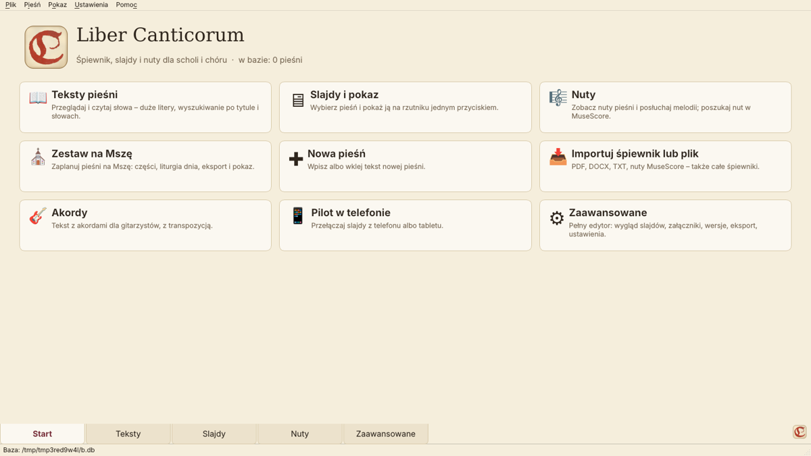
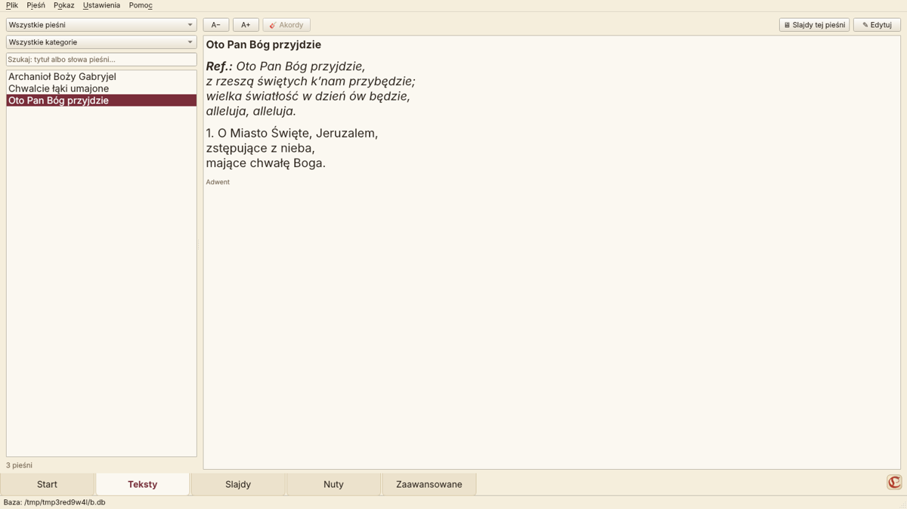
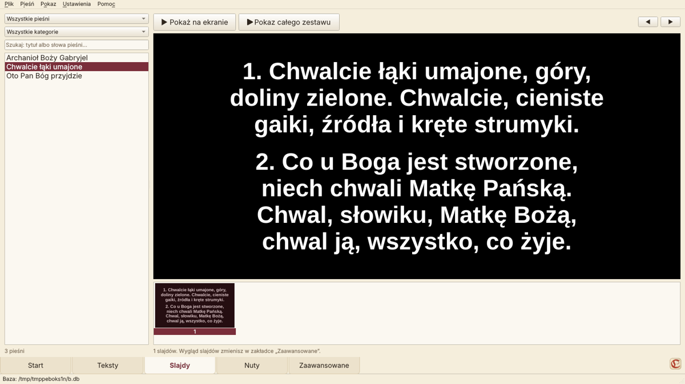
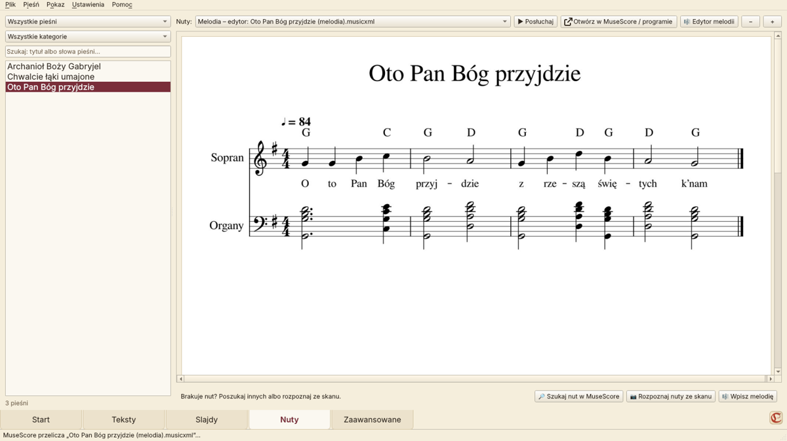
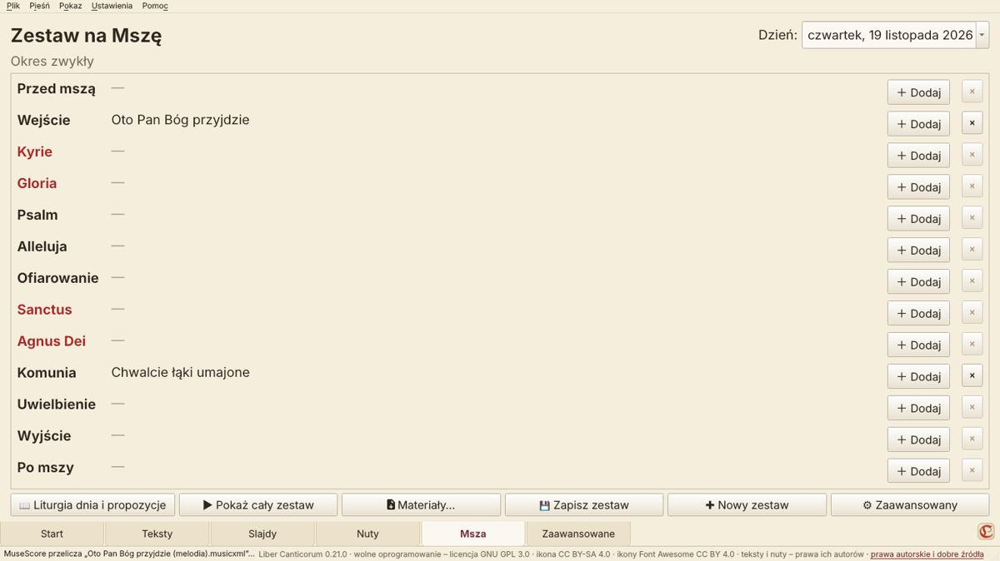
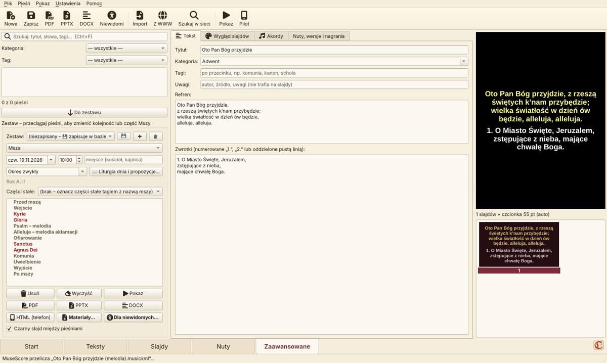
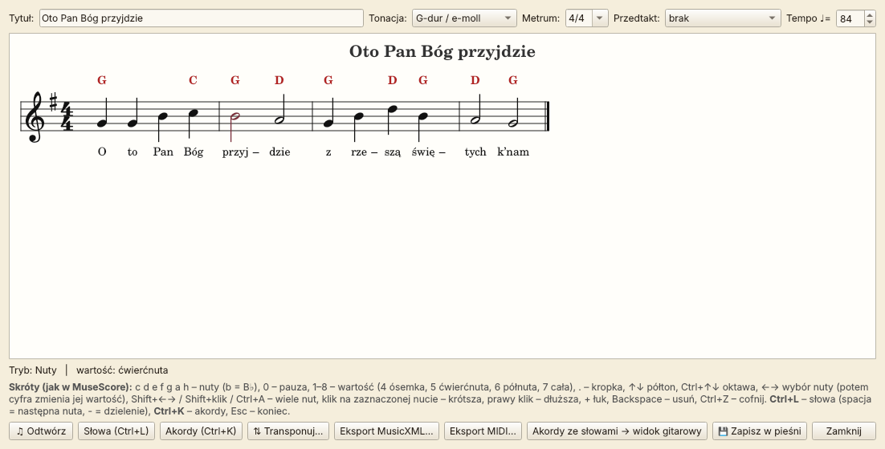
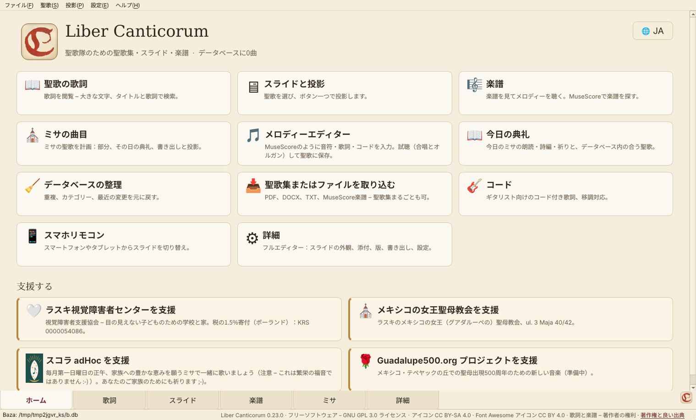
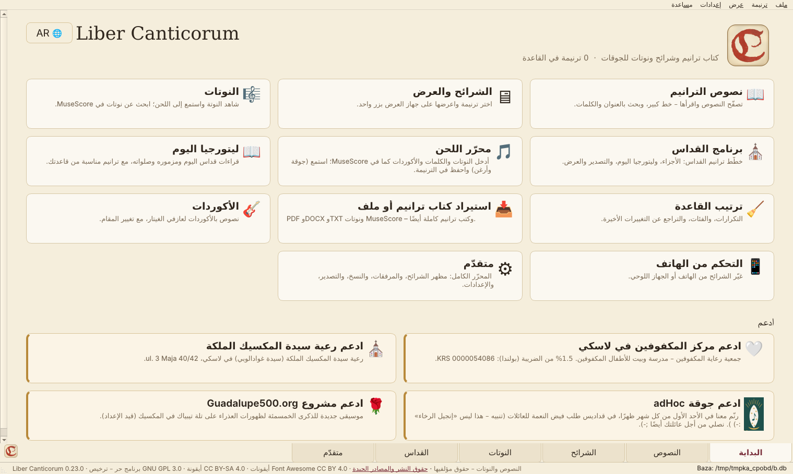

<p align="center"></p>

# Liber Canticorum 0.29.4
*Wolny śpiewnik liturgiczny dla muzyków, chórów i wspólnot Kościoła*  
*A free liturgical songbook for musicians, choirs and Church communities*

🌐 **Polski** · [English](README.en.md) · [Français](README.fr.md) · [Español](README.es.md)

> **PL** – Wolny program (GNU GPL 3) do przygotowywania i wyświetlania tekstów pieśni na rzutniku, z nutami,
> odtwarzaczem głosów, edytorem melodii, akordami, zestawem na Mszę i liturgią dnia. Pełny opis po polsku – poniżej.
>
> **EN** – Free software (GNU GPL 3) for preparing and projecting song lyrics in church, with scores, a voice player,
> a melody editor, guitar chords, Mass sets and the liturgy of the day. It starts with an empty database – you add
> the songs yourself. **Full description in English: [README.en.md](README.en.md).**
>
> **Interfejs programu / Program interface – 26 języków / languages:** Polski · English · Français · Español ·
> Deutsch · Italiano · Português · Українська · Čeština · Slovenčina · Hrvatski · Magyar · Română · Lietuvių ·
> Svenska · Norsk · Íslenska · Kiswahili · Filipino (Tagalog) · Tiếng Việt · 日本語 · 中文 · 한국어 · മലയാളം ·
> العربية · Latina. Opis po francusku i hiszpańsku / description in French and Spanish:
> [Français](README.fr.md) · [Español](README.es.md). Opis w pozostałych językach – w przygotowaniu; interfejs
> jest już dostępny (🌐 na ekranie Start) / description in other languages coming; the interface is already available
> (🌐 on the Home screen). *Tłumaczenia mile widziane / translations welcome: `program/i18n/<kod>.json`.*

*Liber canticorum* to po łacinie „księga pieśni”. *Liber* znaczy „księga”, a zarazem przywodzi na myśl
*libre*, czyli „wolny”, jak wolne oprogramowanie. Ikona to czerwone inicjałowe **C** z pierwszej
strony **Kancjonału staniąteckiego A** z 1586 roku (*Cancional pyosnek rozmaitich a naboznych*), postawione na karcie
pergaminu. [Kancjonały staniąteckie](https://pl.wikipedia.org/wiki/Kancjona%C5%82y_stani%C4%85teckie) (łac. *cantionale*, kantyczki) to kolekcja piętnastu rękopisów
z opracowaniami pieśni religijnych (oznaczanych literami A–P), przechowywana w Opactwie Mniszek Benedyktynek
w Staniątkach.

Program do przygotowywania i wyświetlania slajdów z tekstami pieśni (rzutnik, ekran w kościele),
z nutami, odtwarzaczem głosów, pilotem w telefonie i śpiewnikiem offline. To następca wersji „Śpiewnik – slajdy” 7.x.
Działa na Windows, macOS i Linux. Startuje z pustą bazą: teksty, nuty i nagrania wpisujesz i dodajesz sam.

**Numeracja wersji.** Od wersji 0.9.7 program ma numerację 0.x.y (wcześniejsze wydania nosiły numery 7.x–9.7).
0.x oznacza, że program wciąż szybko się rozwija; kolejne wydania to 0.21.x, 0.22.1 itd.

## Jak wygląda

| Start | Teksty |
|---|---|
|  |  |
| **Slajdy** | **Nuty** |
|  |  |
| **Msza** | **Zaawansowane** |
|  |  |
| **Edytor melodii** | |
|  | |

*Na zrzutach są pieśni z domeny publicznej wpisane do pustej bazy. Program nie zawiera żadnych tekstów ani nut.*

## Języki / Languages / Langues / Idiomas

Opis po angielsku, francusku i hiszpańsku: [English](README.en.md) · [Français](README.fr.md) · [Español](README.es.md).

Interfejs jest w **26 językach**: polskim, angielskim, francuskim, hiszpańskim, niemieckim, ukraińskim, czeskim,
włoskim, portugalskim, suahili, japońskim, chińskim, wietnamskim, norweskim, szwedzkim, islandzkim, chorwackim,
arabskim (od prawej do lewej), litewskim, filipińskim (tagalskim), słowackim, węgierskim, rumuńskim,
koreańskim, malajalam i **po łacinie** (dla miłośników tradycji – bez kafla gitarowego :-) ). Przycisk **🌐** w prawym górnym rogu ekranu
Start albo **Ustawienia → 🌐 Język / Language** (zmiana po ponownym uruchomieniu; domyślnie język systemu).
Teksty i nuty pieśni się nie zmieniają.

| Japoński | Arabski (od prawej do lewej) |
|---|---|
|  |  |

Angielski, francuski i hiszpański obejmują najważniejsze części programu; pozostałe języki – części najbardziej
widoczne (zakładki, menu, Start, widoki proste, Msza, odtwarzacz, edytor melodii, akordy). **Czego brak w danym
języku, program pokazuje po angielsku.** Tłumaczenia na nowe języki są robocze – nazwy części Mszy i okresów
liturgicznych warto dać do sprawdzenia osobie, która mówi tym językiem i zna jej liturgię.

**Jak dodać albo poprawić tłumaczenie** (bez programowania): pliki `i18n/<kod>.json` zawierają
pary „tekst polski” → „tłumaczenie”; puste `""` = jeszcze nieprzetłumaczone.
Wzorce mają miejsca na wartości, np. `"Zaznaczone pieśni: {n}": "Selected songs: {n}"` (`{n}` – liczba).
- nowy język: `python3 i18n/wyciagnij_teksty.py xx` – powstanie `i18n/xx.json` ze wszystkimi tekstami do przetłumaczenia,
  a język pojawi się w menu,
- po zmianach w programie: `python3 i18n/wyciagnij_teksty.py` – dopisze nowe teksty do wszystkich plików.
*Translations welcome – just fill in the empty strings in `i18n/*.json`.*

## Wesprzyj

<p align="center"></p>

Program jest darmowy. Jeśli Ci się przydaje, wesprzyj – kafle u dołu ekranu Start pokazują opis, **numer konta
(z przyciskiem „Kopiuj numer”)** i otwierają stronę:

| Na co | Konto do wpłat | Strona |
|---|---|---|
| **Ośrodek dla Niewidomych w Laskach** – założony przez bł. Matkę Elżbietę Różę Czacką; Towarzystwo Opieki nad Ociemniałymi Stowarzyszenie, ul. Brzozowa 75, Laski, 05-080 Izabelin | mBank S.A. **02 1140 1010 0000 4399 5800 1002**; BLIK na telefon 572 896 588; 1,5% podatku: KRS 0000054086 | [laski.edu.pl](https://laski.edu.pl/) (darowizny: [wpłać darowiznę](https://laski.edu.pl/wplac-darowizne/)) |
| **Parafia M.B. Królowej Meksyku** (z Guadalupe), ul. 3 Maja 40/42, 05-080 Laski | PKO BP **18 1020 1026 0000 1102 0016 9920** | [parafiawlaskach.pl](https://parafiawlaskach.pl/) (konto: [kontakt](https://parafiawlaskach.pl/kontakt)) |
| **Schola Liturgiczna adHoc** – kochamy muzykę, zwłaszcza chóralną i tę, która towarzyszy liturgii, i nie możemy nie śpiewać :-). Śpiewem służymy wspólnocie parafii M.B. Królowej Meksyku w Laskach; promienie w naszym logo to zachwyt nad niepojętym działaniem Boga. Jesteśmy odpowiedzialni za Mszę o bogactwo łaski dla rodzin – byłych, obecnych i przyszłych, we wszystkich ich potrzebach (to nie jest prosperity gospel :-) ). Modlimy się także za Twoją rodzinę ;-). [Kim jesteśmy](https://dowiaryprzezliturgie.pl/adhoc/2026/10/10/kim-jestesmy/) | bez konta – **śpiewaj z nami**: Msza w I niedzielę miesiąca o 12:00 w kościele w Laskach (ul. 3 Maja 40/42), próby we wtorki o 19:00 w domu parafialnym. Mieszkasz daleko, np. na innym kontynencie? Módl się z nami i przyślij swoją intencję ;-) | [dowiaryprzezliturgie.pl/adhoc](https://dowiaryprzezliturgie.pl/adhoc/) |
| **Guadalupe500.org** – nowa muzyka na 500-lecie objawień Matki Bożej na wzgórzu Tepeyac w Meksyku (w przygotowaniu) | bez konta – **włącz się**: komponujesz, śpiewasz, grasz, piszesz teksty, tłumaczysz? | guadalupe500.org |

Numery kont pochodzą ze stron odbiorców (stan: listopad 2026) – przed przelewem sprawdź je u źródła.
Adresy stron kafli są w pliku `wsparcie.json` (obok programu) i można je tam zmienić.

## Układ okna: zakładki u dołu

Okno ma u dołu sześć zakładek. Pierwsze pięć jest prostych, dla każdego, szósta to pełny edytor.

- **Start** – kafle najważniejszych funkcji: Teksty pieśni, Slajdy i pokaz, Nuty, Zestaw na Mszę, **Edytor melodii**, **Liturgia z dnia** (czytania i propozycje pieśni na dziś), **Porządki w bazie** (duplikaty, menedżer kategorii, cofanie zmian),
  Importuj śpiewnik lub plik, Akordy, Pilot w telefonie, Zaawansowane. Na górze liczba pieśni w bazie.
- **Teksty** – przeglądanie słów: kategoria, wyszukiwanie po tytule i słowach, duże litery (A− / A+),
  akordy jednym przyciskiem, „Slajdy tej pieśni”, „Edytuj”.
- **Slajdy** – wybierz pieśń, zobacz slajdy i pokaż je na rzutniku jednym przyciskiem („Pokaż na ekranie”);
  także „Pokaż całego zestawu”.
- **Nuty** – nuty pieśni do przewijania i powiększania (− / +), „Posłuchaj”, „Otwórz w MuseScore”,
  **„Edytor melodii”**; gdy nut brak: „Szukaj nut w MuseScore”, „Rozpoznaj nuty ze skanu”, „Wpisz melodię”.
- **Msza** – prosty zestaw na Mszę dużym pismem: dzień, części Mszy z pieśniami; przy każdej pieśni „↺” (zmień
  na inną) i „✕” (usuń), zaraz za nimi „＋ Dodaj” (z wyszukiwaniem i podpowiedziami ★ dla danej części);
  „✎ Części Mszy…” – własne części i ich kolejność, „📖 Liturgia dnia i propozycje”, „▶ Pokaż cały zestaw”, „📦 Materiały”,
  „💾 Zapisz zestaw”; „⚙ Zaawansowany” – pełny zestaw (rodzaj, godzina, miejsce, części stałe, przeciąganie).
- **Zaawansowane** – pełny edytor: menu i pasek narzędzi, lista pieśni, wygląd slajdów, akordy,
  załączniki („Nuty, wersje i nagrania”), wersje tekstu, zestaw na Mszę, eksport, ustawienia.

Nad listą pieśni w prostych widokach są: wybór „Wszystkie pieśni / Pieśni z zestawu”, **kategoria** i wyszukiwanie.
Wybrana pieśń zostaje ta sama we wszystkich zakładkach (Teksty, Slajdy, Nuty i edytor w „Zaawansowanych”) –
nawet gdy w innej zakładce jest ustawiony filtr, który by ją ukrywał. Program pamięta ostatnio otwartą zakładkę.
Wygląd: jasny pergamin bez ozdobników, w prawym dolnym rogu inicjał „C” z kancjonału (logo programu)
(Ustawienia → „Wygląd: jasny pergamin” – można wyłączyć).

## Krok po kroku: nowe funkcje

**Nowość w 0.29 – bogatszy śpiewnik offline na telefon.** Śpiewnik offline (Plik → Eksport śpiewnika offline HTML
albo ⇩ Offline w pilocie) ma teraz **transpozycję akordów** o pół tonu (krzyżyki albo bemole, zapamiętana dla każdej
pieśni) i pokazuje **zestaw na Mszę z podziałem na części i uwagami dla muzyków** (wykonawca, tonacja, uwagi, na co
zwrócić uwagę). To jeden plik otwierany w przeglądarce: nic nie trzeba instalować ani publikować, działa bez internetu
i niczego nie wysyła. Z dołączonymi nutami organista i chórzyści widzą nuty na pełnym ekranie i przewracają strony
dotknięciem albo pedałem.

**Nowość w 0.27 – czytania w innych językach.** Gdy interfejs nie jest po polsku, „Liturgia z dnia” pobiera
czytanie i Ewangelię dnia z **Vatican News** („Słowo na dziś”) w języku interfejsu (angielski, hiszpański, francuski,
portugalski, a także włoski i niemiecki, jeśli strona odpowie; w pozostałych – po angielsku) i według nich proponuje
pieśni. Obok są przyciski do krajowych mszalików: USCCB i Universalis (EN), AELF (FR), Schott – Beuron (DE),
CEI (IT), Dominicos (ES). **Po łacinie** okno pokazuje wprost *Proprium Missae* z Mszału 1962 (Introitus, Oratio,
Lectio, Graduale, Evangelium, Offertorium, Secreta, Communio, Postcommunio – po łacinie, z Missale Meum) i według niego
proponuje pieśni. Daty wyświetlają się w języku interfejsu.

**Strony z czytaniami (0.27.2).** W oknie „Liturgia z dnia” przycisk „📋 Strony z czytaniami – wybierz…” otwiera
listę stron z czytaniami na wybrany dzień: Vatican News we wszystkich językach serwisu (strony „Słowo na dziś”
po angielsku, włosku, francusku, niemiecku, hiszpańsku i portugalsku – wprost na ten dzień, pozostałe – strona
główna języka), krajowe mszaliki, polskie mszaliki, Ordo 1962. Można dopisać **własny adres** z datą w adresie
({YYYY} {MM} {DD}), np. mszalik swojej diecezji – będzie na górze listy (★).

**Nowości w 0.26.**
- **Menedżer źródeł** (Plik → „📚 Menedżer źródeł…”, kafel „Porządki”, przycisk ⚙ przy liście źródeł) – zmiana nazw,
  łączenie podobnych („Siedlecki” / „Śpiewnik Siedleckiego”), nowe, usuwanie. Źródło jednej lub wielu pieśni:
  zaznacz je na liście (także jedną) i „📚 Źródło dla zaznaczonych…” (menu pod prawym przyciskiem, menu Pieśń).
- **Wygląd slajdów:** na górze „Zwrotek na slajd” i „Obraz tła” – to, co zmienia się najczęściej.
- **Tłumaczenia okien:** po angielsku przetłumaczony jest teraz cały program (także okna pomocnicze, podpowiedzi,
  komunikaty, prawa autorskie); w pozostałych językach to, czego jeszcze nie ma, pokazuje się po angielsku.
- **Po łacinie** okno „Liturgia z dnia” ma odnośniki do liturgii tradycyjnej (Mszał 1962): *Proprium diei* w
  [Missale Meum](https://missale.bieda.it/) i *Ordo* na [propria.org](https://propria.org/).

**Podziel się melodią lub aranżacją (nowość w 0.25).** Wpisaną melodię albo własne opracowanie (na scholę, chór,
organy) udostępnij na [MuseScore.com](https://musescore.com/) **z licencją otwartą** – CC0 (domena publiczna) albo
CC BY / CC BY-SA – żeby mogły z niej korzystać inne wspólnoty. W edytorze melodii: „🌍 Udostępnij na MuseScore.com…”
(eksport MusicXML, przycisk „Upload” i krótka instrukcja), także Pomoc → „🌍 Udostępnij swoje melodie…”.
Udostępniaj tylko to, do czego masz prawo: własne opracowania i melodie z domeny publicznej; w opisie podaj źródło
melodii i słów.

**Za granicą.** W innych językach niż polski kafel parafii zachęca, by znaleźć najbliższą parafię Matki Bożej
z Guadalupe i ją wesprzeć (przycisk „🔎 Znajdź najbliższą parafię…” otwiera mapę).

**Uwagi do pieśni w zestawie (nowość w 0.23).** W zakładce **Msza** przy każdej pieśni jest **📝** – wykonawca
(np. schola, organista, kantor; program pamięta wpisanych), tonacja, uwagi (np. „zwrotki 1, 3, 5”) i **na co zwrócić
uwagę**. Uwagi widać pod tytułem pieśni, zapisują się z zestawem. „📋 Plan dla muzyków” otwiera tabelę do druku
(część, pieśń, źródło, tonacja, wykonawca, uwagi); plan trafia też do folderu „📦 Materiały”. W „Zaawansowanych” –
przyciski „📝 Uwagi…” (dla zaznaczonej pieśni) i „📋 Plan dla muzyków”.

**Źródło pieśni (nowość w 0.23).** Każda pieśń ma pole **Źródło** – śpiewnik albo zbiór (np. Siedlecki, Niezbędnik
Katolika, Niepojęta Trójco). Przy imporcie ze strony program wpisuje je sam (z adresu), istniejące pieśni z importu
dostają je przy pierwszym uruchomieniu. Źródło można:
- wpisać lub wybrać w „Zaawansowanych” (pole pod kategorią) albo nadać wielu zaznaczonym pieśniom naraz
  („📚 Źródło…” w prostych widokach, menu kontekstowe listy w „Zaawansowanych”);
- filtrować: lista pieśni (Teksty, Slajdy, Nuty, Zaawansowane), wybór pieśni w zakładce Msza i **propozycje
  w „Liturgii z dnia”** (lista „Źródło”, kolumna „Źródło” w wynikach); źródło widać obok tytułu.

**Własne części Mszy (nowość w 0.22).** Wprost w wykazie zakładki **Msza** przy nazwie każdej części są ikony
**✎** (zmień nazwę), **🗑** (usuń część z zestawu) i **✚** (wstaw nową część poniżej), a pod wykazem –
„✚ Dodaj część Mszy”. Pełny edytor (z kolejnością) – „✎ Części Mszy…”:
1. **✚ Dodaj część…** – np. „Do Maryi”, „Na zakończenie”, „Hymn patronalny” (wstawiana po zaznaczonej).
2. **✎ Zmień nazwę** (albo dwuklik) – pieśni przechodzą razem z przemianowaną częścią.
3. **↑ / ↓** – kolejność; **🗑 Usuń** – pieśni z usuniętej części trafiają do pierwszej części.
4. Pole wyboru przy nazwie = w tej części może być **kilka pieśni** (bez zaznaczenia – jedna, jak Psalm czy Kyrie).
5. **Przywróć domyślne** – standardowy układ. Układ jest zapamiętywany i obowiązuje też w „Zaawansowanym” zestawie.

Przy każdej pieśni w zestawie są przyciski **↺** (wybierz inną pieśń na to miejsce) i **✕** (usuń), a **＋ Dodaj**
stoi tuż za ostatnią pieśnią danej części.

**Wpisać melodię (edytor melodii, nowość w 0.16).** Kafel **„🎵 Edytor melodii”** na ekranie Start (dla wybranej
pieśni albo nowej – wystarczy podać tytuł), zakładka Nuty → „🎼 Edytor melodii” (albo „Wpisz melodię”),
Pieśń → „Edytor melodii…” (Ctrl+Shift+N) albo przycisk przy załącznikach w „Zaawansowanych”.
1. U góry wybierz **tonację** (np. „G-dur / e-moll”), **metrum** (4/4, 3/4, 6/8…), ewentualnie **przedtakt** i tempo.
2. Wpisuj nuty skrótami jak w MuseScore: najpierw cyfra – wartość (**4** ósemka, **5** ćwierćnuta, **6** półnuta,
   **7** cała, **3** szesnastka; **.** – kropka), potem litera – wysokość: **c d e f g a h** (polskie **b** = B♭).
   Znaki przy kluczu działają same, oktawę program dobiera najbliżej poprzedniej nuty. **0** – pauza.
3. Poprawki: **↑ / ↓** o półton, **Ctrl+↑ / ↓** o oktawę, **← / →** wybór nuty (cyfra zmienia wtedy jej wartość),
   **+** łuk, **Backspace** usuń, **Ctrl+Z** cofnij. Kliknięcie myszą też zaznacza nutę. Nuta dłuższa niż reszta taktu
   sama dzieli się na dwie połączone łukiem.
   **Myszą:** kliknięcie zaznacza nutę; **lewy przycisk na zaznaczonej nucie – krótsza wartość, prawy – dłuższa**
   (po kolei: … ósemka, ósemka z kropką, ćwierćnuta, ćwierćnuta z kropką, półnuta …).
   **Wiele nut naraz:** Shift+← / → albo Shift+klik zaznacza zakres, Ctrl+A – wszystko, Esc – koniec zaznaczenia.
   Zaznaczone nuty razem przesuwasz strzałkami, zmieniasz im wartość (cyfra, kropka, lewy/prawy przycisk) i usuwasz.
   **⇅ Transponuj…** – cała melodia o wybraną liczbę półtonów lub o oktawę: program sam zmienia tonację
   i przepisuje akordy (np. G-dur → A-dur, akord D7 → E7); przy zaznaczonych nutach transponuje tylko je.
4. **Ctrl+L** – słowa: piszesz sylabę, **spacja** przechodzi do następnej nuty, **-** dzieli wyraz, **Esc** kończy.
5. **Ctrl+K** – akordy: „G”, „e”, „D7”, „Fis-moll”, „C/E” (polskie: mała litera = moll, H i B); spacja – następna nuta.
6. **♫ Odtwórz** – melodia brzmi jak **chór (Choir Aahs, głos „Sopran”)**, akordy jak **organy (Church Organ)**,
   jeśli jest SoundFont (zob. „Odtwarzacz głosów”).
7. **💾 Zapisz w pieśni** – do pieśni trafiają plik MusicXML (z nutami, słowami, akordami i partią organów,
   do otwarcia w MuseScore) i MIDI. Ponowne otwarcie tego pliku w edytorze pozwala dalej go poprawiać.
   **„Akordy ze słowami → widok gitarowy”** wstawia słowa z akordami (ChordPro) do zakładki Akordy.
   Eksport MusicXML i MIDI do pliku – przyciskami w oknie.

Nuty rysuje czcionka **Leland** – ta sama, której używa MuseScore 4 – a słowa i akordy czcionka **Edwin**
(obie z MuseScore, licencja SIL OFL, dołączone w `czcionki/`).

**Importować śpiewnik.** Start → „Importuj śpiewnik lub plik” (albo Plik → Importuj z pliku): program sam rozpoznaje
rodzaj PDF-a – śpiewnik z nutami, śpiewnik z nutami jako obrazkami albo śpiewnik tekstowy (także z akordami
nad tekstem lub z boku) – i pokazuje listę pieśni do zaznaczenia. Pieśni, które już są w bazie, można połączyć
(inny tekst zostaje wersją, plik nut – aranżacją). Strony WWW: Plik → „Importuj ze strony WWW” (np. dział
Śpiewnika ks. Siedleckiego – program pobiera wszystkie pieśni działu ze zwrotkami i linkami do nagrań, także gdy
dział ma kilka części zrobionych różnymi akordeonami, np. Adwent: „Część pierwsza” i „Część druga”).

**Cofnąć import.** Plik → „Cofnij ostatnie zmiany w bazie” (Ctrl+Shift+Z) – wybierasz zmianę z listy.

**Usunąć duplikaty.** Plik → „Znajdź i połącz duplikaty pieśni” – dla każdej grupy wybierasz pieśń główną,
„Połącz” albo „To nie są duplikaty”; jednym przyciskiem łączysz pieśni o identycznym tekście.

**Połączyć kilka pieśni albo nadać im kategorię – w każdym widoku.** Na liście pieśni (Teksty, Slajdy, Nuty
i „Zaawansowane”) zaznacz kilka pieśni: **Shift+klik** – zakres, **Ctrl+klik** – pojedyncze. Pod listą pojawią się
przyciski **„🔗 Połącz”** (wybierasz pieśń główną; teksty pozostałych zostają wersjami, nuty, nagrania, tagi
i zestawy przechodzą do niej), **„🏷 Kategoria…”** i **„Tagi…”** – te same polecenia są pod prawym przyciskiem myszy,
razem z „Znajdź duplikaty w całej bazie…”. Wszystko można cofnąć: Plik → Cofnij ostatnie zmiany.

**Menedżer kategorii** (przycisk **⚙** obok wyboru kategorii nad każdą listą pieśni, Plik → „Menedżer kategorii”
albo prawy przycisk myszy na liście): lista kategorii z liczbą pieśni i podglądem pieśni w zaznaczonych.
- **✎ Zmień nazwę** – nowa nazwa dla wszystkich pieśni kategorii (także dwuklik),
- **🔗 Połącz zaznaczone** – kilka kategorii (Shift/Ctrl+klik) w jedną, z wyborem albo wpisaniem nazwy,
- **🔍 Znajdź podobne** – zaznacza kategorie, które wyglądają na tę samą („Adwent” / „adwent” / „Adwentowe”,
  „Maryjne” / „Maryjna”), kolejne kliknięcie – następna grupa,
- **✚ Nowa kategoria** – pojawi się na liście wyboru kategorii, zanim przypiszesz jej pieśni,
- **🗑 Usuń kategorię** – pieśni zostają, tylko bez kategorii.
Każdą zmianę można cofnąć: Plik → Cofnij ostatnie zmiany.

**Akordy dla gitarzystów.** Kafel „Akordy”, przycisk „Akordy” w Tekstach albo Ctrl+G: akordy nad sylabami,
transpozycja, pełny ekran, PDF. Nad tekstem są **chwyty na gryfie** wszystkich akordów pieśni (pole „chwyty”) –
w kolejności, w jakiej się pojawiają, i zmieniają się razem z transpozycją: chwyty otwarte (C, a, G, D7, e…),
a pozostałe jako barre w kształcie E albo A (z numerem progu). Kropki to palce, × – struna nie gra, ○ – struna pusta. Akordy wpisuje się w zakładce „Akordy” w ChordPro: `[a]Chwalcie [E]Pana`.

**Znaleźć nuty.** Nuty → „Szukaj nut w MuseScore” (Ctrl+M) – szuka tytułu pieśni na musescore.com; pobrany plik
sam trafia do pieśni. Okno zapisuje nuty zawsze do pieśni, dla której je otwarto (jej tytuł jest na pasku okna) –
nawet jeśli w międzyczasie otworzysz inną; kilka pobranych plików to kilka aranżacji tej pieśni, a ten sam plik
pobrany drugi raz nie dubluje się.

**Aranżacje jednej pieśni.** Pieśń może mieć dowolnie wiele plików nut: melodię, chór SATB, organy, wersję z innego
śpiewnika… W „Zaawansowanych” → „Nuty, wersje i nagrania” zaznacz plik i kliknij „Wersja / aranżacja (opis)…”, żeby
nazwać go np. „Chór SATB” albo „Organy – Siedlecki”. W zakładce Nuty wybierasz aranżację z listy „Nuty:”. Różne
teksty tej samej pieśni to *wersje tekstu* (tamże), a łączenie duplikatów przenosi wszystko do jednej pieśni:
tekst drugiej zostaje wersją, nuty i nagrania przechodzą (identyczne pliki tylko raz), tagi i uwagi się sumują,
zestawy na Mszę wskazują na pieśń wynikową. Nuty tylko na papierze: zeskanuj i „Rozpoznaj nuty ze skanu” (Audiveris) – albo wpisz
melodię w edytorze melodii.

**Posłuchać i ćwiczyć głos.** Nuty → „Posłuchaj”: pasek odtwarzania nad nutami (⏮ ⏪ Odtwórz ⏹ ⏩, suwak,
spacja i strzałki), głosy S A T B osobno, „Ćwicz głos”, tempo, transpozycja, **👁 Pięciolinie** – pokaż ukryte
w pliku MuseScore pięciolinie (np. akompaniament).
Pole **„Klawiatura”** pokazuje pod nutami klawiaturę fortepianu, na której podświetlają się grane właśnie dźwięki
w kolorach głosów – dobre do nauki partii i do szukania dźwięków na organach.
**Transpozycja** zmienia dźwięk i **nuty**: po chwili MuseScore przelicza nuty w nowej tonacji – z kluczem,
znakami i symbolami akordów (G → A, D7 → E7); powrót do 0 pokazuje oryginał od razu. Działa dla plików MuseScore
i MusicXML (także z edytora melodii).
**Okno odtwarzacza otwiera się na pełnym ekranie** (od 0.18): widać nuty, pasek odtwarzania, słowa i klawiaturę.
Na pasku odtwarzania jest zawsze **tempo w ćwierćnutach na minutę** („Tempo ♩ = 72 /min”, jak w nutach);
strzałkami albo kółkiem myszy zwolnisz lub przyspieszysz, ↺ wraca do tempa z nut.
Transpozycja, „Ćwicz głos”, tempo w %, brzmienie, podkład organowy, SoundFont i lista głosów są pod przyciskiem
**„⚙ Więcej ustawień”**. „⛶ Pełny ekran” / F11 / Esc przełącza pełny ekran (program pamięta wybór).
**Nazwy głosów:** przycisk ✎ przy głosie (w „Więcej ustawień”) zmienia jego nazwę, np. „Soprano (kanał 1)” →
„Melodia”; program pamięta nazwy dla tego pliku, a pusta nazwa przywraca nazwę z pliku.
Pole **„Kolory głosów”** koloruje nuty każdego głosu w nutach na kolor z listy głosów (sopran czerwony, alt
pomarańczowy…) – tak samo jak na klawiaturze i wałku pianoli. Nuty przelicza MuseScore (chwilę to trwa); głosy
w jednej pięciolinii (np. S i A) dostają osobne kolory. Działa razem z transpozycją i ukrywaniem pięciolinii.
Pole **„Słowa na dole”** włącza i wyłącza duże słowa bieżącej frazy pod nutami (program pamięta wybór).

## Instalacja i uruchomienie

Po rozpakowaniu w folderze są tylko programy do uruchamiania i ten folder `program`:

```
LiberCanticorum_0.29.4/
├── Liber Canticorum.bat       ← Windows (po 1. starcie obok pojawi się skrót z ikoną)
├── Liber Canticorum.desktop   ← Linux (ikona pojawi się po 1. starcie)
├── Liber Canticorum.command   ← macOS
├── PRZECZYTAJ.txt
└── program/                   ← kod, ikony, tła, baza pieśni, ta dokumentacja
```

Program uruchamiający (`program/uruchom.py`) przy pierwszym starcie tworzy środowisko z bibliotekami
i pokazuje okienko z postępem (w Linuksie bez Tkintera – okno terminala). Trwa to kilka minut i wymaga internetu.
Później program startuje od razu; po aktualizacji brakujące biblioteki doinstalują się same.
W Windows uruchamiający tworzy w folderze skrót „Liber Canticorum” z ikoną (i odświeża go po przeniesieniu folderu),
a pliki dla innych systemów ukrywa. W Linuksie wpisuje ikonę do pliku `.desktop` i chowa pliki innych systemów.

Z terminala: `program/start.sh` (Linux, macOS) albo `program\start.bat` (Windows).

**Skrót w menu i na pulpicie:** `python3 program/uruchom.py --skrot` (Windows: `program\start.bat skrot`).

**Środowisko z bibliotekami jest wspólne dla wszystkich wersji** (od 8.5):
- Linux / macOS: `~/.local/share/LiberCanticorum/venv`, Windows: `%LOCALAPPDATA%\LiberCanticorum\venv`.
- Nowa wersja programu nie pobiera więc ponownie ok. 600 MB bibliotek, tylko doinstalowuje to, co się zmieniło.
- Przy pierwszym uruchomieniu skrypt startowy znajduje `.venv` z poprzedniej instalacji (folder obok)
  i proponuje **przeniesienie** go, co trwa chwilę i nic nie pobiera.

**Przejście z poprzedniej wersji (7.x „Śpiewnik – slajdy” albo wcześniejsza 8.x/9.0):**
- Rozpakuj nową wersję obok starej i uruchom „Liber Canticorum”. Środowisko przeniesie się samo, jak wyżej.
- Przy pierwszym uruchomieniu program przejmie ustawienia oraz zrobi **kopię** bazy pieśni
  ze starego folderu. Stara baza zostaje nietknięta.
- Później w każdej chwili: **Plik → Importuj z poprzedniej instalacji**. Program pokaże bazy znalezione obok
  (z liczbą pieśni i datą), a do wyboru są dwie opcje:
  - **„Dołącz pieśni”:** dodaje pieśni, których jeszcze nie ma, razem z nutami, nagraniami i podglądami MuseScore.
    Do pieśni o tym samym tytule dokłada brakujące załączniki i uzupełnia pustą kategorię, tagi i nagrania.
    Ponowny import niczego nie dubluje. Działa też ze starymi bazami z wersji 7.0,
  - **„Zastąp bieżącą bazę”:** bieżąca baza zostaje zapisana jako kopia zapasowa `.bak-data`,
  - opcjonalnie przenosi też ustawienia: motywy, zestaw, ścieżkę do MuseScore, SoundFont.
- Bazę zapisaną w innym miejscu otworzysz w menu Plik → Otwórz / utwórz inną bazę.

- **Linux / macOS:** `./start.sh` (za pierwszym razem `chmod +x start.sh`).
  Na Debianie, Ubuntu i Mincie mogą być potrzebne pakiety systemowe:
  `sudo apt install python3-venv libportaudio2`.
- **Windows:** dwuklik na `start.bat`. Potrzebny jest Python z python.org z zaznaczonym „Add python.exe to PATH”.

Opcjonalnie możesz doinstalować **odtwarzacz YouTube wbudowany w program** (ok. +250 MB).
Bez niego nagrania otwierają się w przeglądarce.

- Linux / macOS: `./start.sh --odtwarzacz`
- Windows: `start.bat odtwarzacz` (z wiersza poleceń)

Ręcznie wygląda to tak:

```
python3 -m venv .venv
.venv/bin/pip install -r requirements.txt            # Windows: .venv\Scripts\pip ...
.venv/bin/pip install -r requirements-odtwarzacz.txt  # opcjonalnie
.venv/bin/python liber_canticorum.py
```

Żeby odinstalować, usuń folder `.venv`.

## Pliki

| Plik | Co to jest |
|---|---|
| `liber_canticorum.py` | program główny |
| `modul_widoki.py` | proste widoki (Start, Teksty, Slajdy, Nuty), wygląd „pergamin”, monogram |
| `modul_akordy.py` | akordy (ChordPro), transpozycja, widok dla gitarzystów |
| `modul_pdf_tekst.py` | śpiewniki tekstowe PDF (tytuły po kroju pisma, akordy) |
| `modul_pdf_obrazy.py` | śpiewniki PDF z nutami jako obrazkami (msze, części stałe) |
| `modul_omr.py` | rozpoznawanie nut ze skanu programem Audiveris (MusicXML) |
| `modul_i18n.py`, `i18n/` | tłumaczenia interfejsu (en, fr, es) i narzędzie do zbierania tekstów |
| `wsparcie.json` | adresy stron kafli „Wesprzyj” na ekranie Start |
| `modul_instrumenty.py` | klawiatura w odtwarzaczu, chwyty gitarowe na gryfie |
| `modul_edytor.py` | edytor melodii: nuty, słowa, akordy; zapis MusicXML (Sopran – chór, Organy) i MIDI |
| `czcionki/` | czcionki z MuseScore: Leland (znaki nutowe, SMuFL) i Edwin (tekst), licencja SIL OFL 1.1 |
| `zrzuty/` | zrzuty ekranu do tej dokumentacji |
| `modul_nuty.py` | wyszukiwanie nut (CPDL, MuseScore, IMSLP), podgląd nut, odtwarzacz MIDI z głosami |
| `modul_brzmienia.py` | brzmienia odtwarzacza: odtwarzacz SoundFont (.sf2/.sf3) – chór, organy |
| `modul_youtube.py` | wyszukiwanie i odtwarzanie nagrań z YouTube |
| `modul_pilot.py` | pilot w telefonie lub tablecie przez Wi-Fi |
| `modul_html.py` | śpiewnik offline w jednym pliku HTML (telefon, tablet) |
| `ikony.py`, `ikony/` | ikony Font Awesome Free (SVG), barwione kolorem motywu |
| `generuj_tla.py` | generator teł; pozwala odtworzyć lub zmienić obrazy w `tla/` |
| `tla/` | 16 teł (11 ciemnych, 5 jasnych) w wersjach 16:9 i 4:3, `tla.json` z zalecanymi kolorami i marginesami |
| `liber_canticorum.db` | baza pieśni; tworzy się sama przy pierwszym uruchomieniu |
| `generuj_ikone.py` | generator ikony programu (inicjał C z Kancjonału staniąteckiego A, 1586): SVG, PNG, ICO |

## Co potrafi

**Baza pieśni.** Wszystko jest w jednym pliku `liber_canticorum.db` (SQLite): teksty, ustawienia i załączniki.
Inną bazę otworzysz w menu Plik.
- **Kategorie:** okres liturgiczny lub rodzaj, np. Adwent, Maryjne, Eucharystyczne. Można dopisywać własne.
  Lista pieśni jest pogrupowana według kategorii.
- **Tagi:** dowolne, po przecinku, np. *komunia, kanon, schola*. Program podpowiada istniejące tagi.
- **Wyszukiwanie** (Ctrl+F) przeszukuje tytuł, tekst, tagi i uwagi, bez względu na polskie znaki.
  Do tego dochodzą filtry według kategorii i tagu.

**Import:**
- z plików DOCX, ODT, PDF, TXT i HTML,
- ze strony WWW,
- z plików JSON z wersji 6.x.
- **zbiory pieśni**: strona lub plik z wieloma ponumerowanymi pieśniami (np. dział śpiewnika internetowego, jak
  „Pieśni na Adwent” w Śpiewniku ks. Siedleckiego) jest rozpoznawany jako zbiór. Program pokazuje listę znalezionych
  pieśni z podglądem, odznacza te, które już są w bazie, proponuje kategorię z nagłówka działu i zapisuje numer
  pieśni, dział i źródło w uwagach, a linki do nagrań – przy pieśni (opcjonalnie pobiera mp3 jako załączniki).
  Zapis „ * ” zamienia na podział wersów, rozpoznaje „Refren:”, „Antyfona:” i usuwa odsyłacze „Ref.” / „Ant.”.
- **ze słów pod nutami** (Plik → Importuj słowa z nut): MuseScore 3 i 4 (.mscz, .mscx), MusicXML (.musicxml, .mxl),
  MIDI z tekstem (.mid, .kar) i PDF z nutami (np. wydruk z MuseScore). MuseScore nie jest do tego potrzebny.
  Program składa sylaby w słowa, rozdziela zwrotki, rozpoznaje refren (fragment, pod którym jest tylko jedna linijka
  słów, choć gdzie indziej jest ich więcej) i dzieli tekst na wiersze po interpunkcji. Zwrotki wydrukowane zwykłym
  tekstem pod nutami w PDF też są dołączane. Wynik zawsze pokazuje się w oknie importu do poprawienia,
  a plik nut zostaje dołączony do pieśni po jej zapisaniu.
  Ze skanów (PDF bez warstwy tekstu) słów odczytać się nie da.
- **znane pieśni, wersje i aranżacje.** Przy imporcie i przy zapisie nowej pieśni program szuka w bazie tej samej
  pieśni (ten sam lub podobny tytuł, ten sam początek tekstu, tytuł = pierwszy wiersz drugiej). Można wtedy dodać
  pieśń jako nową albo **dołączyć do istniejącej**: inny tekst zapisuje się jako *wersja tekstu* (np. „Śpiewnik
  oazowy 2026, s. 5”), plik nut – jako kolejna *aranżacja* z opisem, a tagi, uwagi, nagrania i źródła się sumują.
  Ponowny import tego samego śpiewnika niczego nie dubluje. W zakładce „Nuty, wersje i nagrania” są wersje tekstu
  (podgląd z porównaniem różnic, „Ustaw jako tekst główny” – poprzedni tekst staje się wersją, nic nie ginie)
  i opis wersji/aranżacji każdego pliku (Melodia, Chór SATB, Organy…). Dwie pieśni, które już są w bazie
  osobno, łączy Pieśń → Połącz z inną pieśnią – zestawy na Mszę wskazują potem na pieśń wynikową.
- **Wygląd slajdów dla wszystkich pieśni:** w zakładce „Wygląd slajdów” przycisk „Zastosuj do wszystkich pieśni
  w bazie…” (numerowanie zwrotek każda pieśń zachowuje swoje); „Ustaw jako domyślne” zapisuje się od razu.
- **Duplikaty** (Plik → „Znajdź i połącz duplikaty pieśni”): program szuka pieśni o tym samym lub bardzo podobnym
  tytule (bez nawiasów, interpunkcji i ogonków), z tym samym początkiem tekstu albo takich, w których tytuł jednej jest
  pierwszym wierszem drugiej. Dla każdej grupy wybierasz pieśń główną i zaznaczasz, które się z nią połączą (inny
  tekst zostaje wersją, nuty, nagrania, tagi i zestawy przechodzą do głównej), albo „To nie są duplikaty” – program to
  zapamięta. Jednym przyciskiem łączy się wszystkie pieśni z identycznym tekstem.
- **Kategoria i tagi dla wielu pieśni naraz:** zaznacz pieśni na liście w „Zaawansowanych” (Ctrl+klik, Shift+klik,
  Ctrl+A) i wybierz Pieśń → „Kategoria dla zaznaczonych pieśni” albo „Tagi dla zaznaczonych pieśni” (także prawym
  przyciskiem myszy na liście). Tagi: „komunia, adwent” dodaje, „-kolęda” usuwa.
- **Cofnij ostatnie zmiany w bazie** (Plik, Ctrl+Shift+Z): przed każdym importem, łączeniem, zamianą tekstu
  i usunięciem pieśni program robi kopię bazy (ostatnie 8, w ukrytym folderze obok bazy). Z listy wybiera się
  zmianę – baza wraca do stanu sprzed niej; bieżący stan też zostaje zachowany, więc cofnięcie można cofnąć.
- **Akordy – widok dla gitarzystów** (zakładka „Akordy”, Pieśń → Akordy, Ctrl+G): tekst z akordami w zapisie
  ChordPro – „[a]Chwalcie [E]Pana” (akord przed sylabą) albo z boku wiersza po „‖”: „Pozdrawiam Cię, Matko ‖ D e / A D”.
  Akordy z boku stoją na środku wolnego miejsca za tekstem, z wyraźnymi odstępami (zapis sklejony z importu PDF,
np. „FBad/gCF”, program rozdziela na „F B a d / g C F”). Widok pokazuje akordy nad sylabami, ma transpozycję (± półtony, krzyżyki albo bemole), wielkość pisma, pełny
  ekran, przechodzenie po pieśniach zestawu (Pieśń → Akordy całego zestawu) i zapis do PDF. Polska notacja
  (H, B, moll małą literą, „is”/„es”) i angielska (B, Bb, Am). Tekst z wierszami akordów nad słowami (wklejony
  albo z pliku TXT/DOCX) zamienia się na ChordPro automatycznie przy imporcie albo przyciskiem. Slajdy pokazują
  sam tekst. Śpiewnik offline HTML (telefon) ma przycisk „🎸 Akordy” z transpozycją.
- **ze śpiewnika PDF, w którym nuty są obrazkami** (np. śpiewnik mszalny zrobiony w calibre – tekstem są tylko
  nagłówki): każda część staje się pieśnią „Msza Rycerska – Kyrie” z kategorią „Części stałe Mszy”, tagami
  „kyrie” i „Msza Rycerska” (zestaw na Mszę od razu proponuje tę mszę jako motyw części stałych) i nutami
  w załączniku PDF – wycięte są tylko systemy tej części, nie całe strony. Nagłówek największy to nazwa mszy,
  średni – podtytuł (np. „In festis duplicibus”), najmniejszy – część; rubryki trafiają do uwag. Jeśli na komputerze
  jest program **tesseract** (OCR, z językiem polskim), program odczytuje też autorów („m.: J. Gałuszka”) i szkic słów
  spod nut – szkic jest zwykle niepełny, więc wstawia się go tylko po zaznaczeniu opcji w oknie importu.
- **ze śpiewnika tekstowego PDF** (setki pieśni: „123. Tytuł”, zwrotki, refreny, akordy z boku – np. śpiewnik
  oazowy złożony w InDesignie): tytuły są rozpoznawane po kroju i wielkości pisma, a nie tylko po numerze,
  więc „1.” zwrotki nie myli się z „1.” pieśni i pieśni się nie zlewają. Akordy (także „(H7) E A H7…”, „/x2”),
  żywa pagina, numery stron, litery działów na marginesie, sentencje w stopce i ramki z boku (np. wersja
  hiszpańska) są pomijane – akordy trafiają do zakładki „Akordy” (nad sylabami, gdy stały nad tekstem, albo
  z boku wiersza). Śpiewniki bez numerów (tytuły kapitalikami, np. „Woda Życia”) też są rozpoznawane – tytuły
  sprawdzane ze spisem treści. Numer pieśni trafia do uwag („…, nr 356”).
- **ze śpiewnika PDF z nutami** (np. śpiewnik oazowy – wiele pieśni, każda z tytułem, autorami, nutami ze słowami
  i dalszymi zwrotkami pod spodem): wystarczy zaimportować plik PDF. Program sam rozpoznaje, że to śpiewnik,
  i pokazuje listę pieśni do zaznaczenia. Z każdej strony bierze tytuł (wiersz nad „t.: … m.: …”), autorów
  (do uwag), dział i poddział (np. „Śpiewy na Eucharystię – Procesja wejścia” → tag „wejście”), refren i 1. zwrotkę
  spod nut (bez akordów i numerów taktów), dalsze zwrotki z tekstu pod nutami – także z następnej strony.
  Kilka pieśni na jednej stronie (np. „Święty” i „Baranku Boży” pod Kyrie) jest rozdzielanych po tytułach
  z autorami albo po tytule tuż nad nutami. Gdy nuty są obrazkiem, pieśń dostaje tytuł i stronę PDF,
  a w uwagach informację, że słów nie dało się odczytać.
  Strony z nutami danej pieśni mogą trafić do niej jako załącznik PDF (duże obrazki są przy tym zmniejszane).
  Ukryte, przycięte warstwy tekstu (częste w plikach z programów DTP) są pomijane. Słowa spod nut zależą od
  odstępów w pliku – czasem dwa słowa się skleją („namradosną”), więc warto je przejrzeć.
- z nut już dołączonych do pieśni: zakładka „Nuty i nagrania” → „Słowa z tych nut → do tekstu pieśni”.

Program sam rozpoznaje refren („Ref.”) i zwrotki („1.”, „2.”).

**Slajdy.** Podgląd zmienia się na żywo. Do wyboru są:
- format 16:9 lub 4:3,
- automatyczny rozmiar czcionki,
- kolory tekstu, refrenu i tła,
- marginesy,
- **obrazy tła**, jasne lub ciemne (szczegóły niżej w części „Tła”).

**Pokaz** (F5) wyświetla się na pełnym ekranie, domyślnie na drugim monitorze (rzutniku).

| Klawisz | Działanie |
|---|---|
| → / spacja / PgDn | dalej |
| ← / PgUp | wstecz |
| B | czarny ekran |
| **C** | **czyste tło** (bez tekstu) |
| Esc | koniec pokazu |

**Dane Mszy i zapisane zestawy.** Nad zestawem wpisujesz dzień, godzinę i miejsce; okres liturgiczny i rok czytań
(A/B/C, I/II) program wylicza sam z daty (można zmienić). Przycisk 💾 zapisuje zestaw w bazie, lista „Zestaw:”
pokazuje zapisane (najnowsze u góry), ✚ zaczyna nowy.

**Zestaw bez okazji.** W polu rodzaju wybierz „Bez okazji”: zamiast części Mszy jest jedna lista utworów
(koncert, próba, nabożeństwo) z nazwą, datą i miejscem; kolejność zmieniasz przeciąganiem. Pieśni przechodzą
między rodzajami bez utraty, a zapisane zestawy bez okazji mają na liście znak ♪.

**Pojedyncza pieśń dla niewidomych:** Pieśń → „♿ Eksport dla niewidomych” (Ctrl+Shift+D, przycisk „Niewidomi”
na pasku) – ten sam DOCX/TXT/HTML z nagłówkami, refrenem i zwrotkami, bez liturgii.

**📖 Liturgia dnia i propozycje.** Program pobiera teksty Mszy z danego dnia: antyfony na wejście i na Komunię,
kolektę, czytania, psalm z refrenem, aklamację, Ewangelię, modlitwę nad darami, prefację i modlitwę po Komunii.
Źródła: gregorianski.pl (pełny mszalik), niezbednik.niedziela.pl i opoka.org.pl (czytania); domyślnie program
próbuje po kolei i uzupełnia brakujące części. Pobrana liturgia zostaje w bazie, więc potem działa bez internetu.
Obok tekstów program pokazuje pieśni z Twojej bazy, które nawiązują do słów i fraz liturgii (np. refren psalmu,
antyfona, Ewangelia), z podpowiedzią, do której części Mszy pasują; ★ oznacza pieśń z kategorii bieżącego okresu.
Jedno kliknięcie dodaje pieśń do zestawu. **Dzień wybierasz w nagłówku okna:** kalendarz (dzień, miesiąc, rok), ◀ / ▶ – dzień wcześniej / później,
◀◀ / ▶▶ – tydzień, „Dziś”, „Najbliższa niedziela” (okres liturgiczny i teksty zmieniają się same; pobrane dni
program pamięta). **Dopasowanie** pieśni do liturgii: *Szeroko* (także pojedyncze wspólne słowa – więcej propozycji),
*Zrównoważone* (zalecane), *Frazy* (co najmniej 3 kolejne słowa z liturgii), *Ściśle* (tylko długie frazy, 4+ słowa);
do tego „Tylko pieśni z kategorii okresu”. Program pamięta wybór. Propozycje pomijają części stałe (Kyrie, Gloria, Sanctus, Agnus Dei – po kategorii, tagach i tytule),
a pieśni z kategorii bieżącego okresu liturgicznego (★) są na liście najpierw. Teksty liturgiczne należą do wydawców (Pallottinum/KEP) –
program ich nie rozpowszechnia, tylko wyświetla je ze stron źródłowych.

**📦 Materiały…** (zestaw) i Pieśń → „Eksport materiałów” – wszystko do jednego folderu: teksty (DOCX, TXT, HTML),
slajdy (PDF, PPTX), nuty PDF (dołączone i przeliczone z MuseScore, także połączone w jeden plik), dołączone nagrania
i **nagrania do nauki** z nut. Przy nagraniach wybierasz **głosy** (S, A, T, B, inne) i **warianty**: całość,
głos z delikatnym podkładem harmonii, sam głos, oraz tempo z nut i/lub wolniejsze. Okno od razu pokazuje,
ile plików powstanie, i ostrzega, gdy jest ich za dużo. **♿ Dla niewidomych** to ten sam eksport z wersją
tekstów dla czytników ekranu (większa czcionka, DOCX + TXT, bez slajdów i obrazków).

**Rozpoznawanie nut ze skanu** (Pieśń → „Rozpoznaj nuty ze skanu / zdjęcia (Audiveris)”, albo przycisk przy
zaznaczonym załączniku PDF/obrazie w zakładce „Nuty, wersje i nagrania”): wolny program **Audiveris** zamienia skan
(najlepiej 300 dpi) na MusicXML (.mxl), który program dołącza do pieśni z opisem „Rozpoznane ze skanu – do
sprawdzenia”. Gdy pieśń nie ma tekstu, słowa spod nut można od razu wstawić. Plik .mxl otwiera MuseScore – tam
poprawia się błędy rozpoznania; z nut powstaje też MIDI i nagrania do nauki. Audiveris instaluje się osobno
(instalator z wbudowaną Javą z github.com/Audiveris/audiveris/releases albo Flatpak `org.audiveris.audiveris`);
program znajduje go sam, a w razie potrzeby: Ustawienia → Ścieżka do Audiveris. Przy PDF-ie wielostronicowym
wybiera się strony. PDF wektorowy (np. zapisany z MuseScore, Sibeliusa albo LilyPonda, bez obrazu skanu) program
sam zamienia w locie na kopię rastrową 300 dpi, bo Audiveris rozpoznaje tylko obrazy. Uwaga na prawa: melodie dawnych pieśni są wspólne, ale współczesne wydania (redakcja, harmonizacje,
skład) bywają chronione – rozpoznane nuty do użytku we własnej parafii, bez publikowania.

**Czyste brzmienie z SoundFontu (od 0.16.2).** Odtwarzacz sam dostraja próbki dźwięków trwających (chór, organy)
do dokładnej wysokości – w popularnych SoundFontach bywają rozstrojone o 5–30 centów, przez co chór z organami
„fałszował” – i wyrównuje wolne początki próbek (chór „aa” potrafi narastać 0,1–0,3 s, więc niektóre nuty wchodziły
za późno). Nuty brzmią teraz równo z rytmem i z kursorem w nutach.

**Akordy z symboli w plikach MuseScore (od 0.16.3).** MuseScore 4 zapisuje odtwarzanie symboli akordów (Bb, Gm, F7…)
jako osobny kanał tego samego instrumentu – akordy grały więc głosem chóru, w tej samej wysokości co melodia,
i krzyżowały się z nią. Odtwarzacz rozpoznaje teraz taki kanał jako **„Akordy (symbole akordów)”**: nie dzieli go
na głosy, gra go na organach i ciszej (60%), a dźwięki akordu sięgające ponad melodię przenosi o oktawę w dół
(bas zostaje). Brzmienie i głośność akordów zmienisz jak dla każdego głosu, a wyłączysz je odznaczając pole.

**Odtwarzacz głosów:** pasek odtwarzania nad nutami – ⏮ od początku, ⏪ / ⏩ 5 s, Odtwórz/Pauza, ⏹, suwak położenia
i czas (spacja – odtwórz/pauza, strzałki – przewijanie). **👁 Pięciolinie** – pokaż albo ukryj pięciolinie w nutach,
np. akompaniament ukryty w pliku MuseScore, który gra, ale go nie widać (wymaga MuseScore; dźwięk się nie zmienia).
Wybór zapamiętuje się dla pliku i obowiązuje też w podglądzie i w zakładce Nuty.

**Szukaj nut w MuseScore po tytule** (Pieśń → „Szukaj nut w MuseScore”, Ctrl+M, albo przycisk w zakładce „Nuty,
wersje i nagrania”): okno od razu szuka tytułu bieżącej pieśni na musescore.com („Msza Rycerska – Kyrie” → „Msza
Rycerska Kyrie”). Jeśli jest wbudowana przeglądarka (moduł PySide6-Addons – program proponuje doinstalowanie,
ok. 150 MB; przed użyciem program sprawdza ją w osobnym procesie, a gdy nie działa – pokazuje dlaczego i pozwala ją
odinstalować), MuseScore otwiera się w oknie programu: wybierasz nuty, klikasz *Download* (PDF albo MuseScore) i plik
od razu trafia do pieśni; logowanie w MuseScore (darmowe konto) program pamięta. Bez niej MuseScore otwiera się
w zwykłej przeglądarce, a pobrany plik pojawia się w oknie sam (folder Pobrane) – wtedy kliknij duży przycisk
**„💾 ZAPISZ nuty w pieśni”**. CPDL, IMSLP i Google są w zakładce
„Inne źródła”. (MuseScore chroni wyszukiwarkę przed programami, dlatego wyniki ogląda się w przeglądarce.)

**Szukaj w sieci** (Plik → „Szukaj w śpiewnikach internetowych i nut w MuseScore”, Ctrl+Shift+F):
1. *Teksty w śpiewnikach* – program pobiera spisy pieśni (Śpiewnik ks. Siedleckiego z tekstami, Śpiewnik
   Niezbędnika Katolika – tytuły, tekst na żądanie) i szuka w nich po tytule i słowach; wynik można zaimportować
   jako nową pieśń albo wstawić do bieżącej.
2. *Nuty w MuseScore* – wyniki z musescore.com w kolejności: **melodia** (jeden głos), potem aranżacje: chór,
   organy/fortepian, inne. Pobrany w przeglądarce plik dołączasz przyciskiem „💾 ZAPISZ pobrane nuty w pieśni”.
3. *Dostępność dla bazy* – tabela dla wszystkich pieśni (albo bieżącej listy): czy tekst jest w śpiewnikach,
   ile jest nut-melodii i aranżacji w MuseScore; zapis do CSV. Zapytania idą co sekundę, żeby nie obciążać serwisu.

**♿ Dla niewidomych…** – naraz kilka formatów (DOCX, TXT, HTML) w jednym folderze, a do tego
**nagrania do nauki** (MP3) z nut dołączonych do pieśni (MIDI albo MuseScore): całość oraz każdy głos osobno
na delikatnym podkładzie całej harmonii (organy, fisharmonia, smyczki albo chór; głośność podkładu i tempo do wyboru).
Teksty podają nazwy plików z nagraniami przy każdej pieśni. Mszalik z pieśniami zestawu i (jeśli pobrana) liturgią dnia, ułożony w kolejności Mszy:
DOCX z prawdziwymi nagłówkami (czytniki ekranu: NVDA, JAWS, VoiceOver, TalkBack), TXT w UTF-8 dla notatników
i monitorów brajlowskich albo HTML do otwarcia w telefonie. Do wyboru pełne teksty, wersja skrócona lub same pieśni
oraz wielkość czcionki dla słabowidzących.

**Zestaw na Mszę** ma części: Przed mszą, Wejście, Kyrie, Gloria, Psalm (melodia), Alleluja (melodia aklamacji), Ofiarowanie, Sanctus, Agnus Dei, Komunia, Uwielbienie, Wyjście, Po mszy. Zaznacz część i kliknij „↓ Do zestawu” (bez zaznaczenia program sam rozpozna część po tytule lub tagu, np. „komunia”). Przy częściach z pieśniami możesz dodać kilka pieśni; części stałe oraz melodia psalmu i aklamacji przyjmują jedną pozycję. Części stałe najlepiej brać z jednej mszy: oznacz pieśni Kyrie/Gloria/Sanctus/Agnus Dei wspólnym tagiem (np. „Msza o Aniołach”) i wybierz ją w polu „Części stałe” – wypełni wszystkie cztery naraz. Pieśni przeciągasz między częściami; pokaz i eksport idą w kolejności Mszy, a w DOCX nagłówek mówi, na którą część jest pieśń.

**Eksport:**
- **PDF**, wygląda identycznie jak podgląd,
- **PPTX**, z tekstem do edycji,
- **DOCX dla osób niewidomych i słabowidzących** (szczegóły niżej).

**Eksport DOCX dla osób niewidomych i słabowidzących:**
- prawdziwe nagłówki: każda pieśń to nagłówek 1. poziomu, więc w czytniku ekranu przechodzi się między nimi klawiszem H,
- język dokumentu ustawiony na polski, żeby syntezator mowy dobrze wymawiał tekst,
- wersy w oryginalnym układzie, z oznaczeniami „Refren:”, „Zwrotka 1:” i „(Refren)” w miejscu powtórzenia,
- bez tabel, obrazów, kolorów i pustych akapitów; czcionka 14 pt,
- plik nadaje się też dla monitora brajlowskiego i do druku powiększonego.

**Nuty i nagrania** (zakładka przy każdej pieśni):
- **załączniki:** nuty PDF, pliki MuseScore (.mscz, .mscx), MusicXML, MIDI i nagrania audio.
  Zapisują się w bazie i otwierasz je jednym kliknięciem (np. .mscz w programie MuseScore),
- **Szukaj nut w sieci:**
  - **CPDL**, darmowa biblioteka nut chóralnych: wyszukiwanie w programie, lista plików utworu
    i pobranie ich prosto do pieśni,
  - **MuseScore, IMSLP, Google:** wyszukiwanie w przeglądarce, bo te serwisy nie mają otwartego API.
    Pobrany plik dodajesz przyciskiem „Dodaj pliki…”,
- **Odtwarzacz MIDI do nauki głosów:**
  - czterogłos jest rozpoznawany automatycznie jako sopran, alt, tenor i bas,
    także wtedy, gdy plik ma wszystkie głosy w jednej ścieżce jako akordy,
  - każdy głos można wyciszyć albo ustawić mu głośność,
  - tryb **„Ćwicz głos”**: wybrany głos gra głośno, pozostałe ciszej,
  - tempo od 25 do 200 % i transpozycja,
  - wałek pianoli z kursorem; kliknięcie przewija utwór,
  - zapis tego, co słychać (wybrane głosy, brzmienia, tempo, transpozycja) do **MP3**, OGG, FLAC albo WAV
    – przycisk „Zapisz MP3 / WAV…” na pasku odtwarzania; program pamięta format i folder,
- **YouTube:**
  - wyszukiwanie w programie przez oficjalne API; potrzebny jest własny, darmowy klucz
    („YouTube Data API v3” z Google Cloud Console). Bez klucza wyszukiwanie otwiera się w przeglądarce
    i wklejasz link,
  - nagrania zapisane przy pieśni,
  - **Wideo:** odtwarzacz YouTube na pełnym ekranie rzutnika,
  - **Tylko dźwięk + czyste tło:** odtwarzacz w małym okienku na Twoim ekranie, a rzutnik pokazuje samo tło slajdu.

Odtwarzanie idzie przez oficjalny osadzony odtwarzacz YouTube. Program nie pobiera i nie wycina ścieżek
dźwiękowych, bo zabrania tego regulamin YouTube.
Publiczne odtwarzanie nagrań i wyświetlanie tekstów może wymagać zgody właścicieli praw (np. przez ZAiKS).
Za to odpowiada użytkownik.

## Nuty z MuseScore

Pliki **.mscz**, .mscx i MusicXML program **pokazuje**, ale ich nie edytuje.
Jeśli MuseScore 3 lub 4 jest zainstalowany na komputerze, program po dołączeniu pliku
w tle przelicza go do PDF (podgląd) i MIDI (odtwarzacz głosów).
Wynik zapisuje w bazie, więc te nuty widać potem także w pilocie i w śpiewniku offline,
gdzie MuseScore nie jest już potrzebny. Bez MuseScore widać miniaturę pierwszej strony.
MuseScore jest wyszukiwany automatycznie. Jeśli się nie znajdzie, wskaż go w menu Ustawienia → Ścieżka do MuseScore.

**MuseScore 4 na Linuksie (AppImage).** MuseScore 4 na Linuksie wydawany jest jako plik AppImage. Program:
- **sam go znajduje** w folderach `~/Applications`, `~/Aplikacje`, `~/Programy`, `~/AppImages`, `~/bin`,
  `~/Pobrane`, `~/Downloads`, `~/Pulpit`, `/opt` i innych. Gdy plików jest kilka, wybiera najnowszą wersję,
- **sam nadaje mu prawo do uruchamiania** (`chmod +x`), bo pobrane pliki zwykle go nie mają,
- **radzi sobie bez FUSE.** Nowsze Ubuntu i Mint nie mają domyślnie biblioteki `libfuse2`, bez której AppImage nie startuje.
  Program wtedy sam przełącza się na tryb bez FUSE (`APPIMAGE_EXTRACT_AND_RUN=1`).
  Działa to wolniej o kilka sekund na konwersję. Szybciej będzie po instalacji
  `sudo apt install libfuse2` (Ubuntu 22.04, Mint 21) albo `sudo apt install libfuse2t64` (Ubuntu 24.04, Mint 22),
- przy wskazywaniu pliku w Ustawieniach **sprawdza, czy MuseScore działa**, i pokazuje jego wersję,
- przycisk **„Otwórz w programie”** otwiera pliki .mscz wprost w tym MuseScore, także wtedy, gdy AppImage
  nie jest w systemie skojarzony z plikami .mscz,
- radzi sobie ze znanymi kaprysami MuseScore 4 w linii poleceń:
  - pomocniczy proces obsługi awarii, który zostaje w tle (program bierze gotowy plik i zamyka MuseScore),
  - kod błędu przy zamykaniu, mimo że plik zapisano,
  - kłopoty z oknami (wtedy próbuje trybu bez okien).

**Ustawienia → Test MuseScore** wykonuje próbną konwersję krótkiego utworu i pokazuje raport:
wersję MuseScore, użyty tryb, wynik (PDF, MIDI, pozycje nut) i dziennik z komunikatami MuseScore.
Przycisk „Kopiuj raport” kopiuje go do schowka, żeby łatwo było go komuś przesłać.
Przycisk „Otwórz w programie” otwiera plik w MuseScore do edycji.

**Podgląd nut** (dwuklik na załączniku):
- przewijanie strona po stronie: strzałki, spacja, pedał Bluetooth albo kliknięcie,
- dwie strony obok siebie,
- tryb „do szerokości”,
- pełny ekran (F11),
- przycisk „Głosy (MIDI)”.

**Jak dodać nuty:**
- przeciągnij plik na okno programu: nuty trafiają do bieżącej pieśni, a teksty (DOCX, TXT…) są importowane,
- albo otwórz „Szukaj nut w sieci…”. To okno nie blokuje programu.
  Pliki pobrane w przeglądarce (np. z MuseScore.com) **pojawiają się w nim same**, bo okno pilnuje folderu Pobrane.
  Zaznaczasz je i klikasz „Dołącz”.
- CPDL bywa niedostępny dla programów (ochrona przed botami). Wtedy program otwiera CPDL w przeglądarce.

## Odtwarzacz głosów: brzmienia i nuty ze słowami

**Brzmienia z SoundFontu,** czyli prawdziwe nagrane próbki:
- barwy **Choir Aahs** (chór „aa”), **Voice Oohs** (chór „uu”), **Church Organ** (organy kościelne),
  **Reed Organ** (fisharmonia), fortepian, smyczki i inne,
- osobna barwa dla każdego głosu (np. bas na organach) oraz suwak **„Podkład organowy”** pod śpiewanymi głosami,
- program sam znajduje pliki SoundFont na komputerze, w tym bibliotekę brzmień instalowaną z MuseScore (.sf3)
  i FluidR3 (.sf2). Inny plik wskażesz przyciskiem „SoundFont…”,
- gdy na komputerze nie ma żadnego SoundFontu, odtwarzacz gra prostym tonem i podpowiada, co zrobić.
  „Skąd pobrać?” otwiera stronę darmowego **GeneralUser GS**: pobierz go i wskaż plik .sf2 przyciskiem „SoundFont…”,
- odtwarzacz SoundFont jest wbudowany w program (numpy), bez FluidSynth i bez kompilowania czegokolwiek.
  Nie ma pogłosu ani filtrów, więc brzmienie bywa trochę „suchsze” niż w MuseScore.

**Nuty ze słowami w czasie odtwarzania:** głosy otwierane z pliku MuseScore (.mscz) pokazują nad wałkiem pianoli
**prawdziwe nuty ze słowami**:
- **kursor przesuwa się po nutach razem z dźwiękiem**, a strony przewracają się same,
- kursor zgadza się z dźwiękiem także przy zmienionym tempie,
- **kliknięcie nuty przewija odtwarzanie do tego miejsca**, co jest wygodne do ćwiczenia trudnego fragmentu,
- położenie nut zapisuje MuseScore podczas konwersji (.spos) i zostaje ono w bazie,
- nuty i wałek pianoli włączasz i wyłączasz osobno,
- **powiększanie nut:** przyciski −/+, „Szerokość”, „Strona” albo Ctrl + kółko myszy. Przy mniejszym
  powiększeniu widać całą frazę, a nie jeden takt. Program zapamiętuje ustawienie.

**Słowa pod nutami** (gdy plik MIDI zawiera tekst, np. z MuseScore 4):
- duża czcionka z regulacją A−/A+,
- każda zwrotka w osobnym wierszu,
- cała fraza widoczna naraz, a po sylabach przeskakuje tylko czerwone zaznaczenie, więc tekst nie miga.

Przycisk **„MIDI – odtwarzanie głosów”** otwiera odtwarzacz dla plików MIDI oraz dla plików MuseScore.

**Pliki MIDI ze słowami** (karaoke, .kar) wyświetlają bieżący fragment tekstu i podświetlają aktualną sylabę.
Polskie znaki są odczytywane z UTF-8 albo Windows-1250.

## Telefon i tablet

**Pilot** (menu Pokaz → Pilot w telefonie, Ctrl+P): telefon i komputer muszą być w tej samej sieci Wi-Fi.
Gdy Wi-Fi nie ma, włącz hotspot w telefonie i połącz z nim komputer. Zeskanuj kod QR aparatem telefonu.
Nic nie trzeba instalować, działa też na iPhonie i iPadzie. Pilot ma zakładki:
- **Pokaz:** bieżący i następny slajd, przyciski ◀ ▶ (albo przesunięcie palcem), czarny ekran, czyste tło, start i koniec pokazu,
- **Slajdy:** miniatury; dotknięcie przełącza slajd na rzutniku,
- **Pieśni:** wyszukiwanie w bazie; „Pokaż” wyświetla pieśń na rzutniku,
- **Nuty:** nuty bieżącej pieśni na pełnym ekranie (PDF, zdjęcia, MuseScore), pobieranie plików
  oraz **„Dodaj z telefonu”**: zdjęcie nut, PDF albo MIDI trafia od razu do pieśni w bazie,
- **Zestaw:** pieśni zestawu i pokaz całości,
- **⇩ Offline:** pobranie śpiewnika offline na telefon albo tablet (cały albo sam zestaw, z nutami lub bez).

Dostęp chroni 6-cyfrowy PIN zawarty w kodzie QR. Pilot działa tylko wtedy, gdy go włączysz.
Na Windowsie zezwól zaporze na dostęp w sieci prywatnej.

**Śpiewnik offline** to jeden plik HTML. Pobierzesz go przez pilota albo zapiszesz w menu
Plik → Eksport śpiewnika offline lub przyciskiem „HTML (telefon)” przy zestawie.
Działa bez internetu i bez komputera, w każdej przeglądarce. Nic nie trzeba instalować, a plik niczego nie wysyła:
- **tekst** dla śpiewających: duża czcionka, motyw jasny, sepia lub ciemny,
- **slajdy** na pełnym ekranie z tłami, np. telefon podłączony do rzutnika kablem USB-C–HDMI,
- **nuty** dla organisty i chóru: przewracanie dotknięciem lub pedałem Bluetooth, w poziomie dwie strony, ekran nie gaśnie,
- **akordy** z transpozycją o pół tonu (krzyżyki albo bemole, tonacja zapamiętana dla każdej pieśni),
- **zestaw na Mszę** z podziałem na części i uwagami dla muzyków (wykonawca, tonacja, uwagi, na co zwrócić uwagę),
- wyszukiwanie, kategorie, zestaw w kolejności.

**Chmura (Nextcloud, Google Drive) – na razie:** trzymaj `liber_canticorum.db` i wyeksportowany śpiewnik HTML
w folderze synchronizowanym na komputerze (klient Nextcloud lub Dysk Google na komputer).
Na telefonie otwierasz plik HTML z aplikacji Nextcloud lub Dysk.
Bazy nie edytuj jednocześnie na dwóch komputerach.

**W planach:** aplikacja na Androida (PySide6) z pełną obsługą chmury z telefonu,
czyli pobieraniem i dodawaniem pieśni i nut bez komputera.
Dla Nextcloud przez standardowy WebDAV, dla Google Drive przez API Google.

## Tła

**Jasne tła w stylu iluminowanych ksiąg chórałowych.** Na nich tekst jest ciemnobrązowy jak atrament,
a refren czerwony jak rubryki:
- **jasne: graduał:** pergamin, czerwona czterolinia z czarnymi neumami u góry i u dołu, złocony inicjał,
  ornament piórkowy w czerwieni i błękicie na marginesie,
- **jasne: chorał renesans:** pięciolinia z notacją menzuralną (brewisy, romby, ligatury, kustosz),
  duży inicjał na złotym polu,
- **jasne: iluminacja:** bordiura z wici, liści i kwiatów oraz inicjał, jak w księgach godzinek,
- **jasne: kolonialny:** wielkie folio chórowe w stylu ksiąg z Meksyku i Limy: duże czarne nuty
  na grubych czerwonych liniach, inicjał w szachownicy, kwiaty i foliacja,
- **jasne: pergamin:** sama karta pergaminu z delikatną liniaturą.

**Ciemne tła:** kodeks (neumy na ciemnym pergaminie), iluminacja (złote wici), adwent (wieniec), Boże Narodzenie
(Gwiazda Betlejemska), maryjne (12 gwiazd, lilie), Wielki Post (krzyż, korona cierniowa), Wielkanoc
(Chi-Rho, Α i Ω), Duch Święty (siedem płomieni), gotyk (ostrołuki), witraż (rozety) i czyste.

Po wybraniu tła program sam ustawia zalecane kolory tekstu i **marginesy**, żeby tekst nie wchodził
na nuty i inicjały. Te ustawienia można potem zmienić.
- Suwak **„Wyciszenie tła”** na ciemnym tle przyciemnia ozdobniki, a na jasnym je rozjaśnia.
- Pod jasnym tekstem rysuje się cień, a pod ciemnym jasna poświata. Dzięki temu tekst jest czytelny
  także tam, gdzie wypada na nuty.

Wszystkie tła są narysowane od zera przez `generuj_tla.py`. Nie są kopiami istniejących rękopisów.
Własny obraz tła wybierzesz opcją „Inny plik…”, a własny motyw dodasz, wrzucając plik JPG lub PNG do folderu `tla/`.

## Prawa autorskie do pieśni i dobre źródła

To samo jest w programie: Pomoc → „Prawa autorskie do pieśni…” i link w stopce okna.

### Krótko i życzliwie

Program jest wolny, ale **teksty, melodie i nuty, które do niego wpisujesz, mają swoich autorów**.
Prawa do pieśni bywają złożone – jedna pieśń to często kilka utworów naraz:

- **tekst** (autor słów, a w pieśniach tłumaczonych – także tłumacz),
- **melodia** (kompozytor),
- **opracowanie** – harmonizacja, aranżacja na chór lub organy, akompaniament,
- **wydanie** – redakcja tekstu, skład nut, opracowanie śpiewnika.

Majątkowe prawa autorskie wygasają co do zasady **70 lat od śmierci twórcy** (a w pieśni napisanej razem przez
autora słów i kompozytora – od śmierci tego z nich, który zmarł później; art. 36 ustawy o prawie autorskim).
Dawna pieśń może więc być wolna, a jej **współczesne wydanie, nowy przekład czy harmonizacja – nie**.
Pieśni „ludowe” i „tradycyjne” też mają często nowsze, chronione wersje tekstu.
Ustawa pozwala **korzystać z utworów podczas ceremonii religijnych**, jeżeli nie łączy się z tym osiąganie
pośrednio lub bezpośrednio korzyści majątkowej (art. 31 ust. 1). Co innego jednak koncerty, nagrania udostępniane
w internecie, transmisje, kopiowanie i rozpowszechnianie śpiewników czy nut – tu zwykle potrzebna jest zgoda
autorów lub wydawców (np. przez ZAiKS albo bezpośrednio). Teksty liturgiczne (czytania, psalmy, modlitwy) należą
do wydawców ksiąg liturgicznych.
**Prosimy:** szanuj pracę autorów i wydawców – podawaj źródło (w uwagach pieśni), nie publikuj w sieci cudzych
nut i nagrań bez zgody, a śpiewniki z programu (PDF, HTML) traktuj jako pomoc dla własnej wspólnoty.
To nie jest porada prawna – w razie wątpliwości zapytaj wydawcę, ZAiKS albo prawnika.

### Dobre źródła tekstów i nut

Najlepiej korzystać ze **sprawdzonych, starannie opracowanych wydań** – mają poprawne teksty, zatwierdzone
do liturgii, i opisane źródła:

- **Śpiewnik kościelny ks. Jana Siedleckiego** – [spiewniksiedleckiego.pl](https://spiewniksiedleckiego.pl/)
(teksty z nagraniami melodii),
- **Śpiewnik Liturgiczny** (Lublin, KUL) – wydanie zatwierdzone do liturgii,
- **Mszał, Lekcjonarz, Graduał** – teksty liturgiczne (śpiewy międzylekcyjne, antyfony),
- nuty w domenie publicznej: [CPDL](https://www.cpdl.org/) (chóralne),
[IMSLP](https://imslp.org/); na [MuseScore](https://musescore.com/) sprawdzaj licencję opracowania.

Wszystkie śpiewy przeznaczone do liturgii powinny mieć aprobatę Konferencji Episkopatu Polski albo władzy
diecezjalnej (Instrukcja Episkopatu Polski z 1979 r., n. 10).

### Dokumenty Kościoła o muzyce

- Sobór Watykański II, konstytucja *Sacrosanctum Concilium* (1963), rozdz. VI „Muzyka sakralna” – podstawa,
- Instrukcja *Musicam sacram* (1967) – [tekst](https://musicamsacram.pl/dokumenty/pobierz/ins),
- Instrukcja Episkopatu Polski o muzyce liturgicznej po Soborze Watykańskim II (1979) –
[tekst](https://musicamsacram.pl/dokumenty/pobierz/instr79),
- św. Jan Paweł II, *List do artystów* (1999),
- św. Jan Paweł II, *Chirograf na stulecie motu proprio „Tra le sollecitudini” o muzyce sakralnej* (22.11.2003)
– w serwisie [vatican.va](https://www.vatican.va/),
- Benedykt XVI, adhortacja *Sacramentum caritatis* (2007), n. 42 – o śpiewie liturgicznym,
- **Instrukcja Konferencji Episkopatu Polski o muzyce kościelnej** (14.10.2017) – obowiązująca w Polsce –
[tekst](https://musicamsacram.pl/dokumenty/pobierz/instr2017),
- Franciszek, list apostolski *Desiderio desideravi* o formacji liturgicznej (2022).

Ustawa o prawie autorskim i prawach pokrewnych (tekst jednolity Dz.U. 2025 poz. 24):
[PDF](https://api.sejm.gov.pl/eli/acts/DU/2025/24/text.pdf).

## Licencja

- **Kod programu:** GNU General Public License w wersji 3 lub późniejszej (GPL-3.0-or-later), pełny tekst w pliku [`LICENSE`](LICENSE).
  Możesz używać, kopiować, zmieniać i rozpowszechniać program, także zmieniony, pod warunkiem
  udostępnienia kodu źródłowego na tej samej licencji. Program jest dostarczany bez gwarancji.
- **Ikony** (`ikony/`): [Font Awesome Free](https://fontawesome.com) 7, Fonticons, Inc., licencja CC BY 4.0
  (`ikony/LICENSE-FontAwesome.txt`). Ikony są w programie barwione kolorem tekstu z motywu systemu.
  W menu Ustawienia:
  - **Pasek narzędzi:** ikony z podpisem, z napisem obok albo same ikony,
  - **Ikony → Styl:** pełne albo **konturowe (lżejsze)**,
  - **Ikony → Kolory:** systemowe, **jasne pastelowe**, białe (pod ciemny wygląd), kolorowe albo złote (liturgiczne).
    Kolory są przypisane do rodzajów działań: pliki, eksport, pokaz, muzyka, sieć, usuwanie.

  Zmiana działa od razu, bez ponownego uruchamiania.
- **Ikona programu** (`ikony/liber_canticorum*`, `ikony/zrodla/`): litera C z pierwszej strony Kancjonału
  staniąteckiego A z 1586 r. (Opactwo Mniszek Benedyktynek w Staniątkach). Fotografia: **Mkonik80**, praca własna,
  licencja **CC BY-SA 4.0**, [Wikimedia Commons](https://commons.wikimedia.org/wiki/File:Staniatki-kanc-A-001.jpg).
  Litera została wycięta ze zdjęcia, oczyszczona z tła i zamieniona na wektor. Ikona jest utworem zależnym,
  więc też jest na licencji **CC BY-SA 4.0** (zgodnej w jedną stronę z GPL-3.0). Szczegóły w `ikony/LICENSE-ikona.txt`.
- **Czcionki** (`czcionki/`): Leland i Edwin, © MuseScore Limited, licencja **SIL Open Font License 1.1**
  (`czcionki/Leland-OFL.txt`, `czcionki/Edwin-OFL.txt`) – można je rozpowszechniać razem z programem bez zmian.
- **Obrazy teł** (`tla/`): CC0 1.0, czyli domena publiczna. Możesz z nimi robić, co chcesz (`tla/LICENSE-CC0.txt`).
- **Biblioteki** mają licencje zgodne z GPL: PySide6 (LGPL-3), python-pptx, python-docx i mido (MIT),
  pypdf, numpy, sounddevice, soundfile i qrcode (BSD/MIT), pypdfium2 (Apache-2.0 / BSD).
- **SoundFonty** nie są dołączone do programu i mają własne licencje (np. GeneralUser GS – licencja zezwalająca
  na swobodne użycie; FluidR3 – MIT; biblioteka brzmień MuseScore – MIT).
